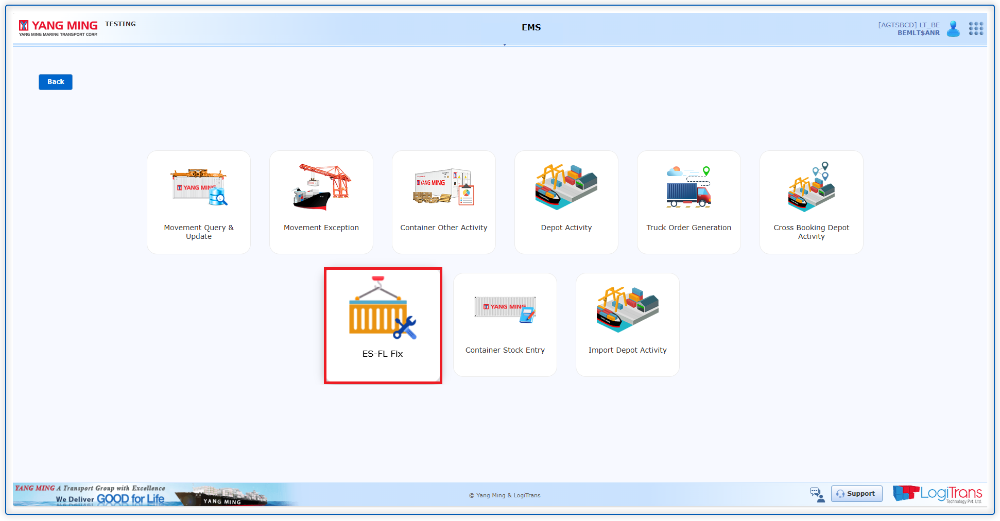

@11 This function used to fix the ES / FL movement for a selected bookings.
@11 For the screen its shows the Selected Booking&#x2019;s Linked to container movement of ES and FL with linked Booking number, move date , Pickup & Turn in ref details.
@11 Here user can select and update the correct Booking of the selected  container.

