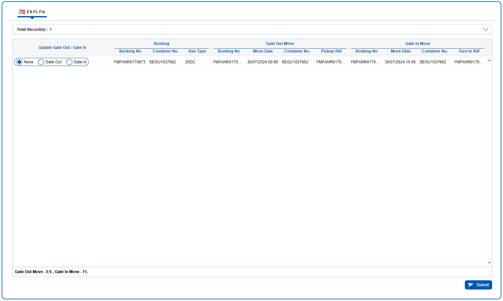

@11 Data Grid Screen allows the user to view data queried using query fields.
@11 This screen allows the user to fix ES, Fl related data errors.
1. Gate out indicates FL Move Activity
1. Gate In indicates ES Move Activity

