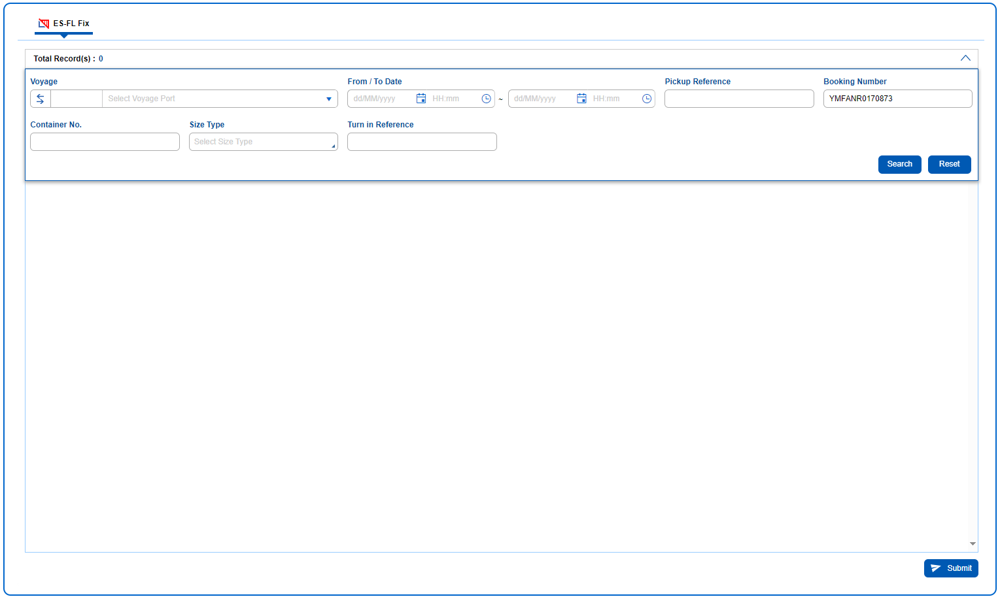

@11 {img:img/ES_FL_Fix_Query_Fields_1537_02.png}- This button allows the user to query data by entering data in fields.
@11 {img:img/ES_FL_Fix_Query_Fields_1537_03.png}- This button allows the user to clear multiple fields at once to query with new data, if required.
