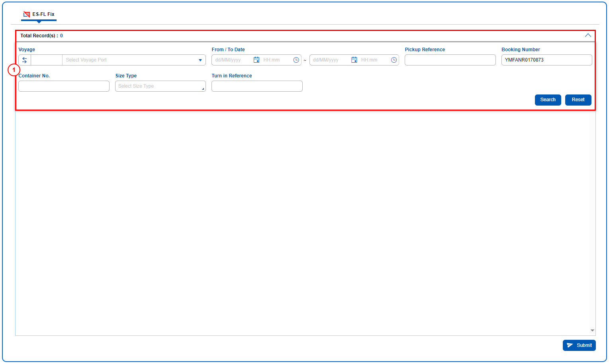
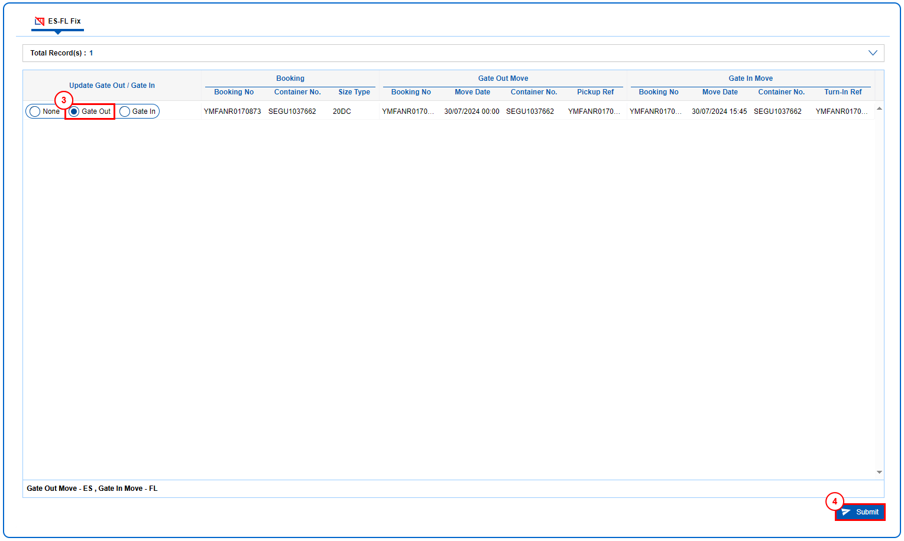
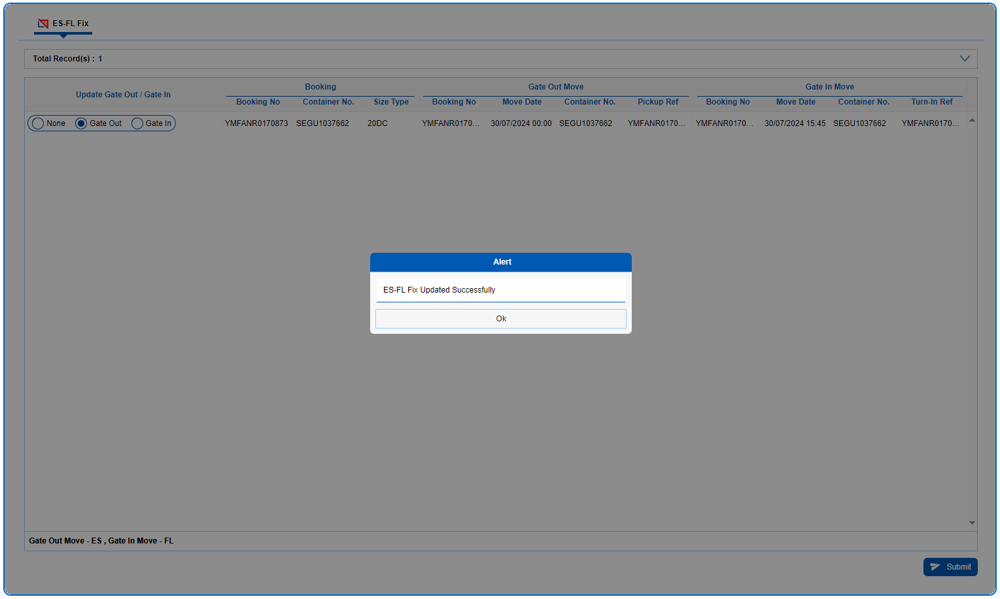

## Pre defined conditions
1.
Booking should be in Entered Status
Container OF Move should be linked to the booking in order to generate this Right fax.
If Booking is having multiple container if any one container having the OF move system will allow to generate this right fax.

## Steps

1. **Step 1** : The user should enter the query fields with desirable input for querying data.

**Step 2** : If data is available, it would be shown in data grid as shown below.
**Step 3** : If Gate out movement is to be updated then {img:img/How_to_fix_ES_FL_for_selected_booking_01d8_02.png} is to be clicked by the user.
**Step 4** : Then the user should click on {img:img/How_to_fix_ES_FL_for_selected_booking_01d8_03.png} to fix data.
1. **Note** : {img:img/How_to_fix_ES_FL_for_selected_booking_01d8_04.png}-  If Gate In movement is to be updated then {img:img/How_to_fix_ES_FL_for_selected_booking_01d8_05.png} can be clicked by the user.

@11 If data is fixed successfully, an alert is displayed as given below.

