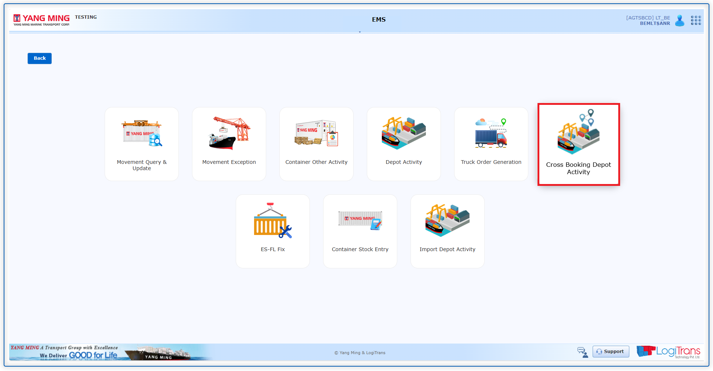
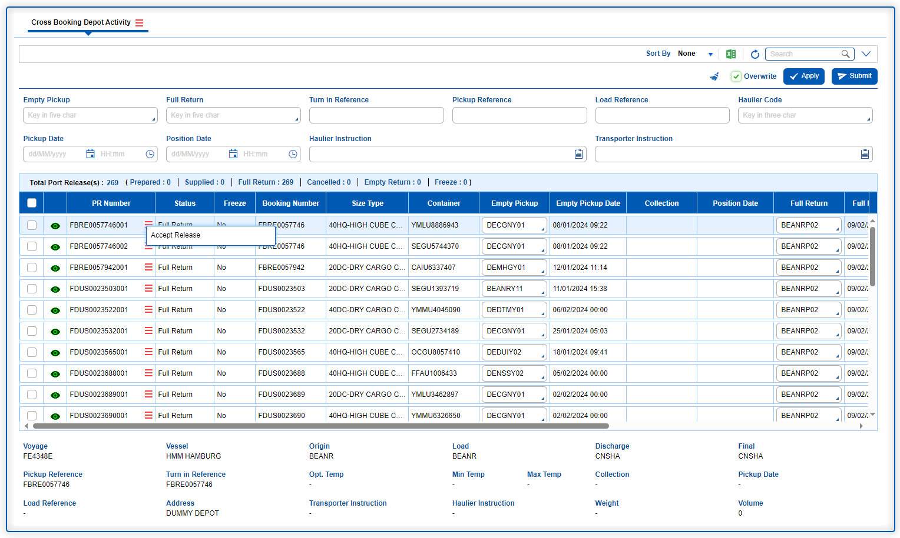
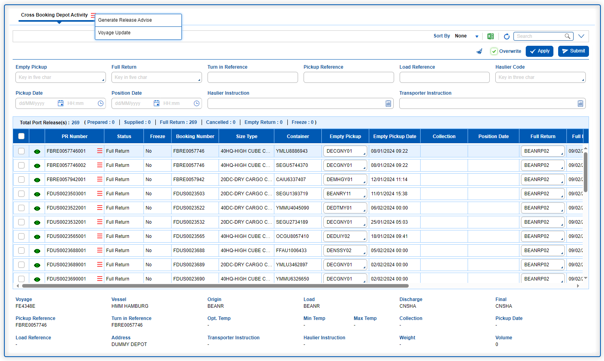

This option is used to update Empty Pickup/Full Return Depot details against booking.
This option allows user can assign Empty Pickup/Full Return Depot/Turn in Reference.

Cross Booking Depot Activity has the following **Single Function**.
    1.
        1. Accept Release

Cross Booking Depot Activity has the following **Group Functions**.
1.
    1. Generate Release Advise
    1. Voyage Update
1.

