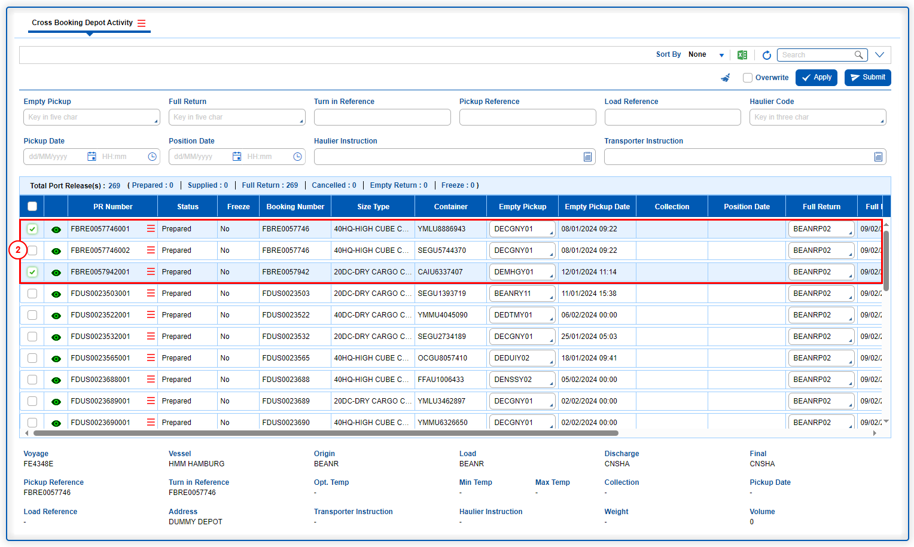
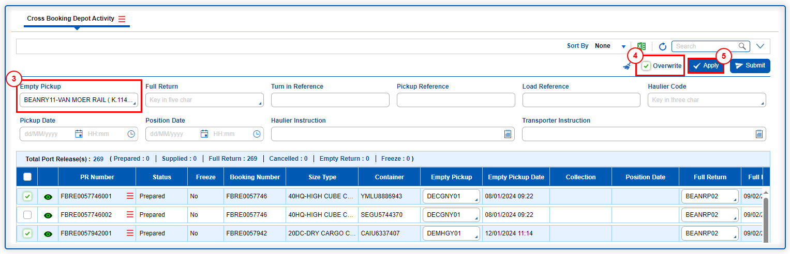
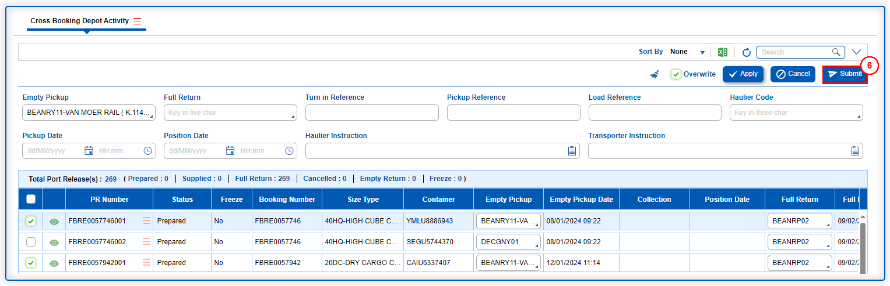
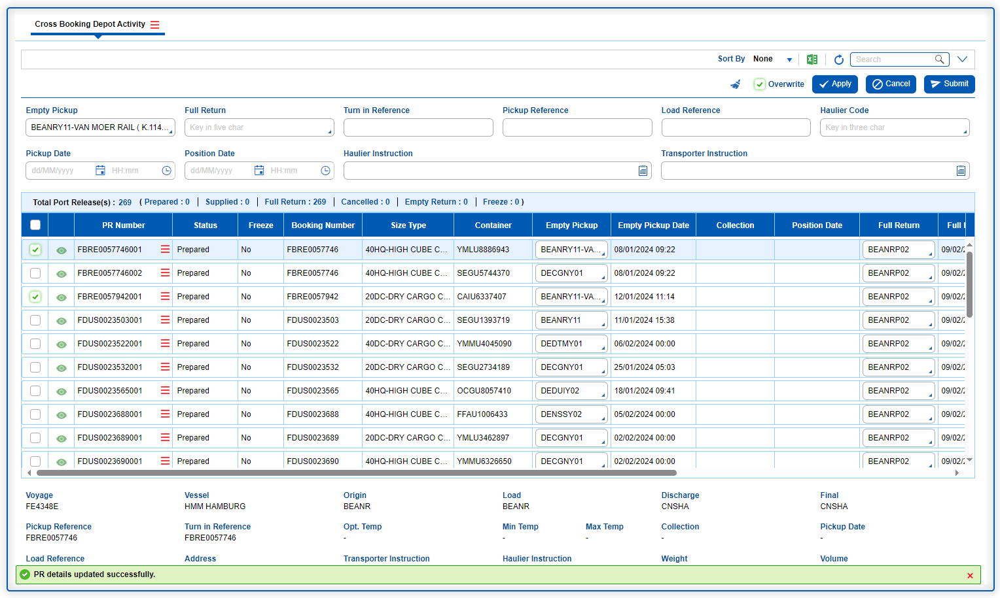

**Step 1** : The user should query depot activity data using cross booking depot activity query fields.
**Step 2** : The user should then select the records where the user wants to change data.

**Step 3** : After the user selects data the user should enter desired data in the Edit fields as highlighted below
            1. **Step 4** : Click on {img:img/How_to_Change_Empty_Return_Full_Return_Edit_Fields_1c20_02.png} checkbox to over write old data with new data.
            1. **Step 5** : Click on{img:img/How_to_Change_Empty_Return_Full_Return_Edit_Fields_1c20_03.png} to preview the new data before actually submitting it.

    1. **Step 6** : Click on{img:img/How_to_Change_Empty_Return_Full_Return_Edit_Fields_1c20_05.png} to submit the new data.

**Step 7** : If the process is successful the user is shown a success message as shown below.

    1.
