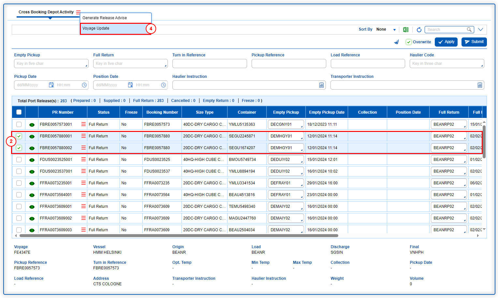
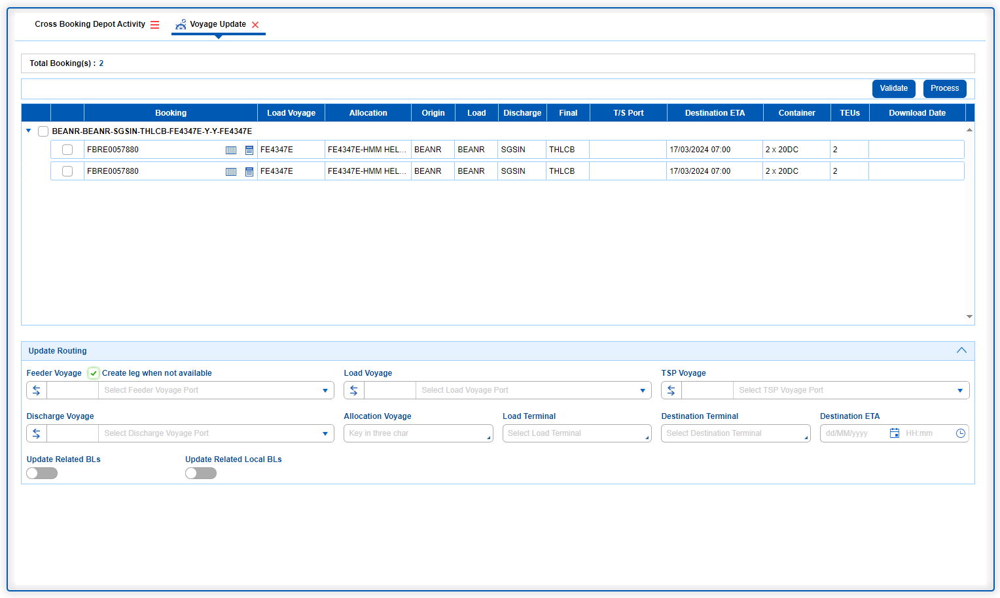
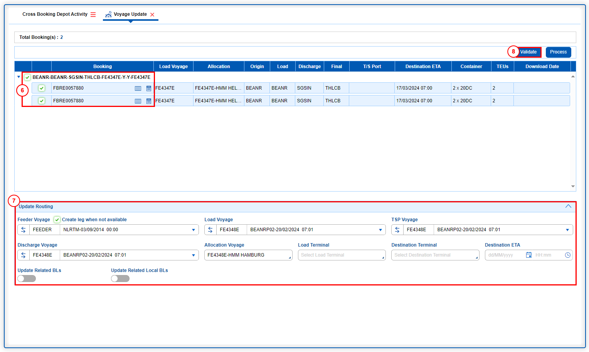
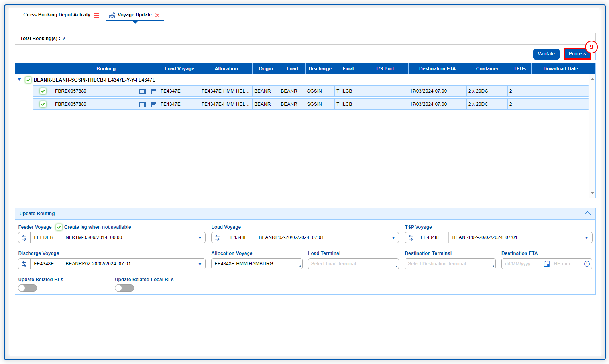
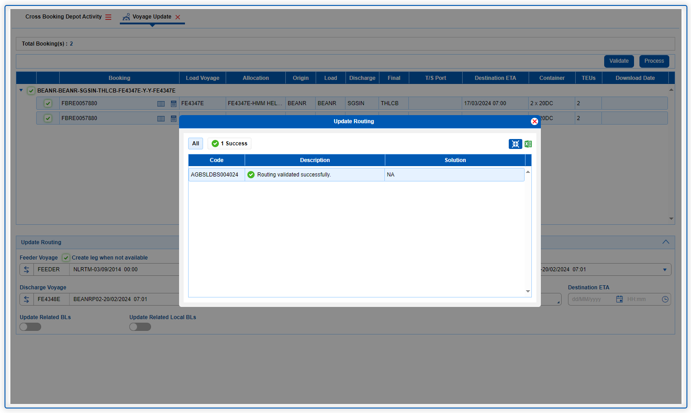
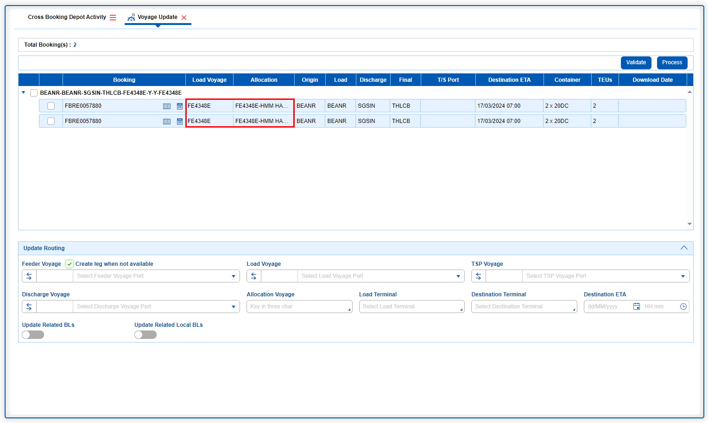

## Pre defined conditions

1. @11 Selected PR&Ds Booking should be in Pre Entered and Entered status.

## Steps

**Step 1** : The user should query data using the query fields.
**Step 2** : The user should then click on the checkboxes to select required bookings from queried bookings.
1.   **Note** **:** The user can select one or many bookings at a time to generate Voyage Update.
**Step 3** : The user should the click on the Menu icon near depot activity and this opens a drop down menu with a list of Group functions
**Step 4** : The user should then click on "**Voyage Update**".

On clicking voyage update from the menu, the user will be taken to Voyage Update screen.
>> 
**Step 6**: the user should then click on either {img:img/How_to_Update_Voyage_8c9d_03.png}(select all check box) or on {img:img/How_to_Update_Voyage_8c9d_04.png}(individual check box)  as per requirement.
**Step 7:** Followed by step 6 the user can choose to fill single or multiple fields in the Update Routing that requires to be updated.
**Step 8:** Once the user has filled the required fields the user can click on {img:img/How_to_Update_Voyage_8c9d_05.png} to validate the changes made.

 If validation process is successful, a result grid is shown as given below.

**Step 9:** Once the user has validated the changes made and decides to process the changes the user can click on {img:img/How_to_Update_Voyage_8c9d_08.png}.

 If changes are processed successfully, a result grid is shown as given below.

On closing result grid the user will be able to see changes applied to data.

## Note

{img:img/How_to_Update_Voyage_8c9d_12.png}**-** This check box allows the user to create a new leg in the voyage if the feeder leg is not available.
{img:img/How_to_Update_Voyage_8c9d_13.png}**-** This toggle allows the user to update all Related BLs with the changes that were made by the user.
{img:img/How_to_Update_Voyage_8c9d_14.png}- This toggle allows the user to update all Related BLs with the changes that were made by the user.

When the user makes the changes to voyage (Load Voyage, Feeder Voyage, Transshipment Voyage, Discharge Voyage) the changes are reflected on Destination Terminal and Destination ETA
