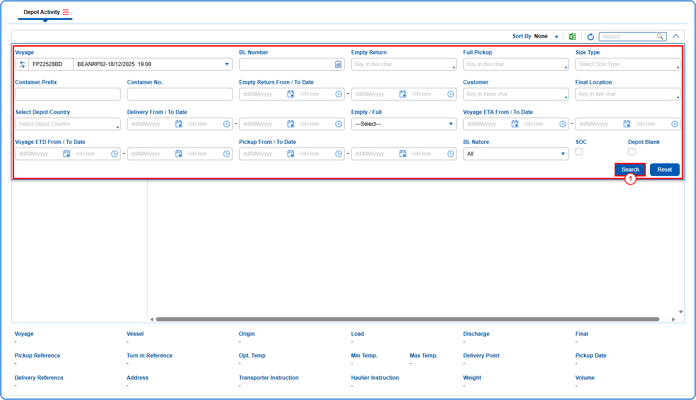
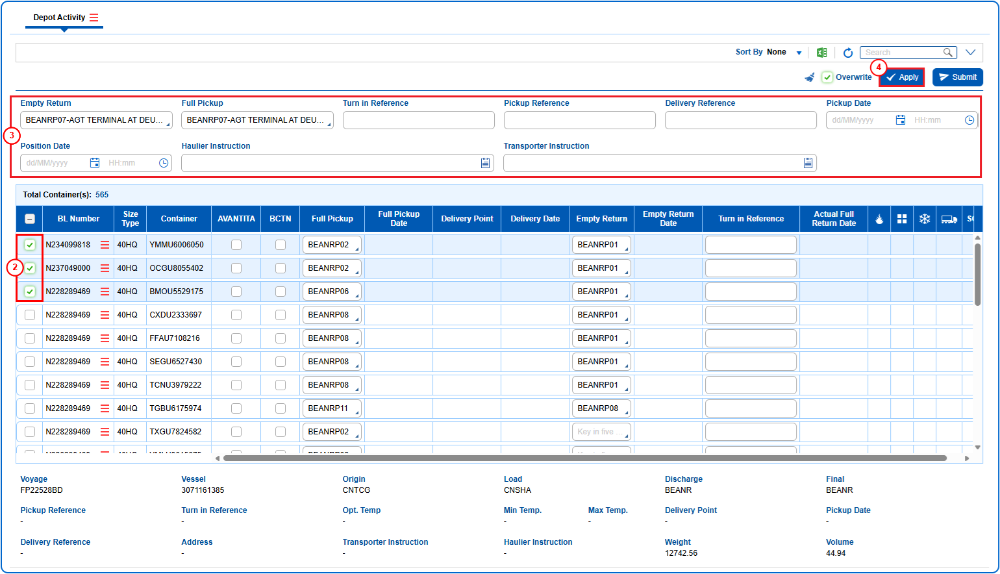
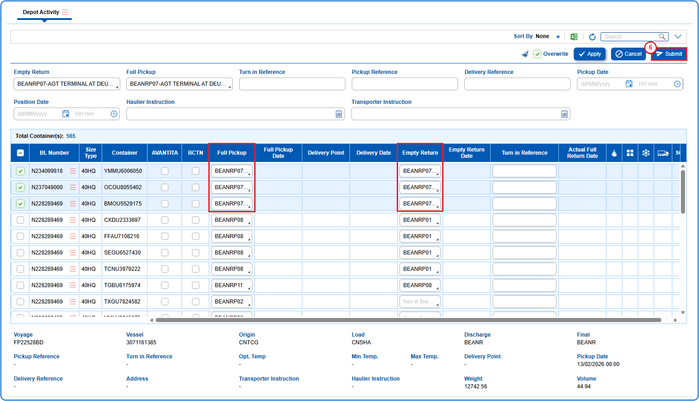
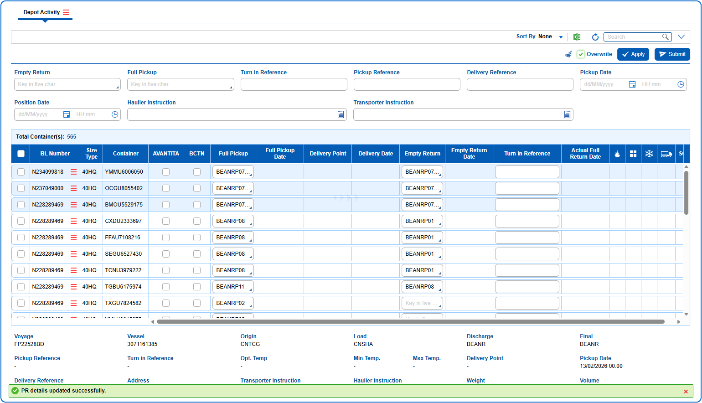

**Step 1** : Query data using the query fields.

**Step 2** : If data is queried, Select the desirable record(s) by either clicking on {img:img/How_to_Change_data_using_Edit_Fields_d1bb_02.png} select all checkbox or {img:img/How_to_Change_data_using_Edit_Fields_d1bb_03.png} individual selection checkbox of the respective records.
**Step 3** : After selection enter the data to be changed in the edit fields as shown below.
    1. **Step 4** : Click on {img:img/How_to_Change_data_using_Edit_Fields_d1bb_04.png}

    1. **Step 5** : On clicking {img:img/How_to_Change_data_using_Edit_Fields_d1bb_06.png}, the applied changes are displayed.
    1. **Step 6** : To confirm and submit change, Click on {img:img/How_to_Change_data_using_Edit_Fields_d1bb_07.png}
    1. Note: To cancel changes, click on {img:img/How_to_Change_data_using_Edit_Fields_d1bb_08.png}

    1.

If successfully submitted, a success message is shown as given below.

    1.
