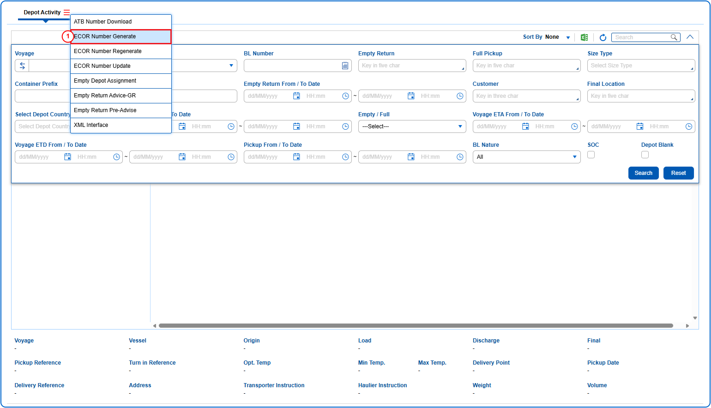
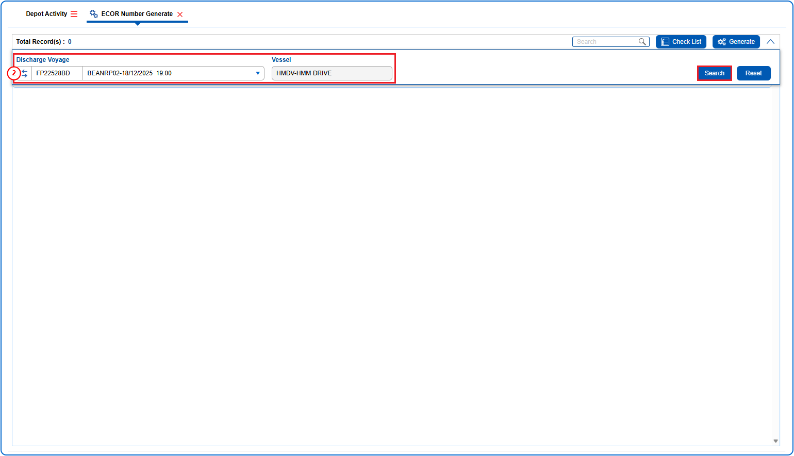
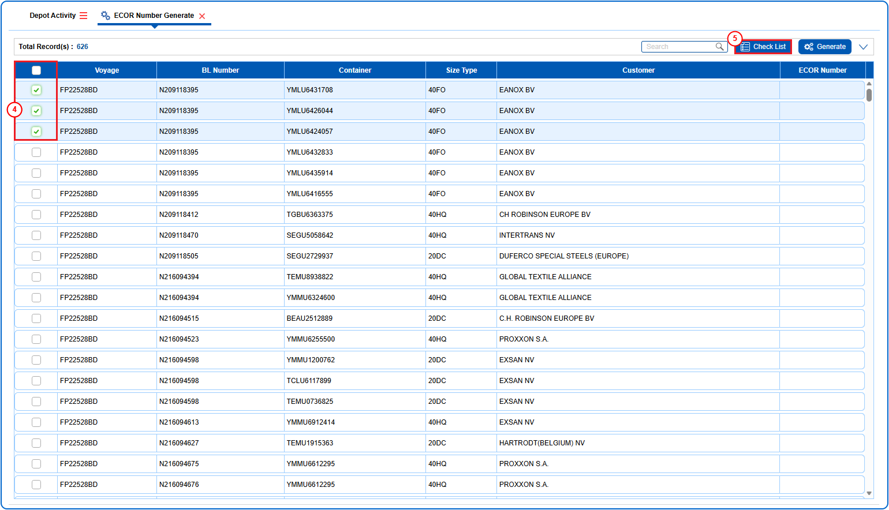
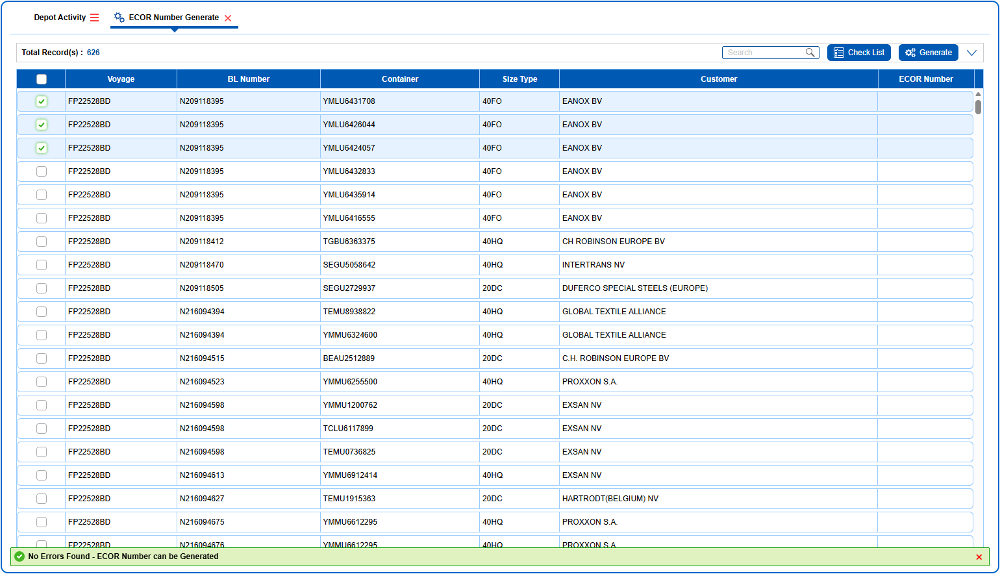
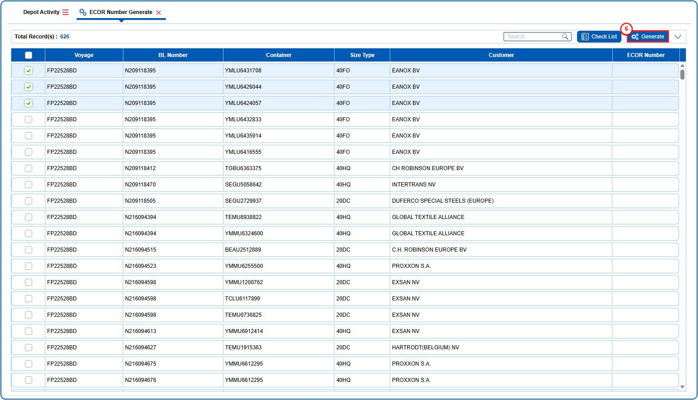
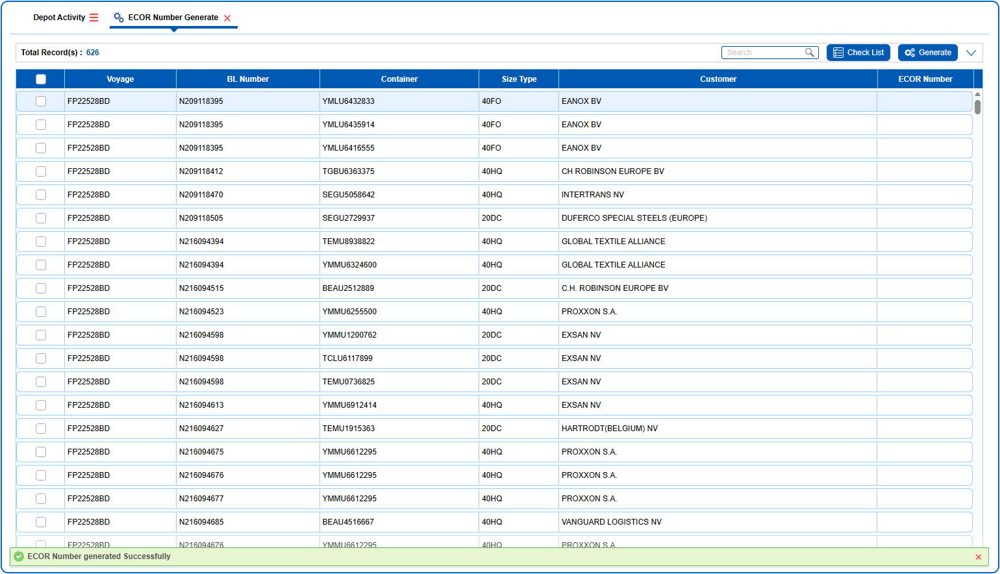

## Steps
**Step 1:** Click on the {img:img/How_to_Generate_ECOR_Number_96b1_01.png} icon (Voyage level) and select **ECOR Number Generate** function from the menu. This will open the ECOR Number Generate screen.

**Step 2:** In the ECOR Number Generate query screen,Enter the required query parameters in the search fields and click on {img:img/How_to_Generate_ECOR_Number_96b1_03.png}.

**Step 3:** Upon clicking {img:img/How_to_Generate_ECOR_Number_96b1_05.png}, records matching the entered criteria will be returned in the data grid.
**Step 4:** Select the desirable record(s) by either clicking on {img:img/How_to_Generate_ECOR_Number_96b1_06.png} select all checkbox or {img:img/How_to_Generate_ECOR_Number_96b1_07.png} individual selection checkbox of the respective records.
**Step 5:** Click on {img:img/How_to_Generate_ECOR_Number_96b1_08.png}.

If Checklist is processed without errors, a success message is displayed.

Step 6: Click on {img:img/How_to_Generate_ECOR_Number_96b1_11.png}.

If Generated successfully, a success message is displayed.
>> 
