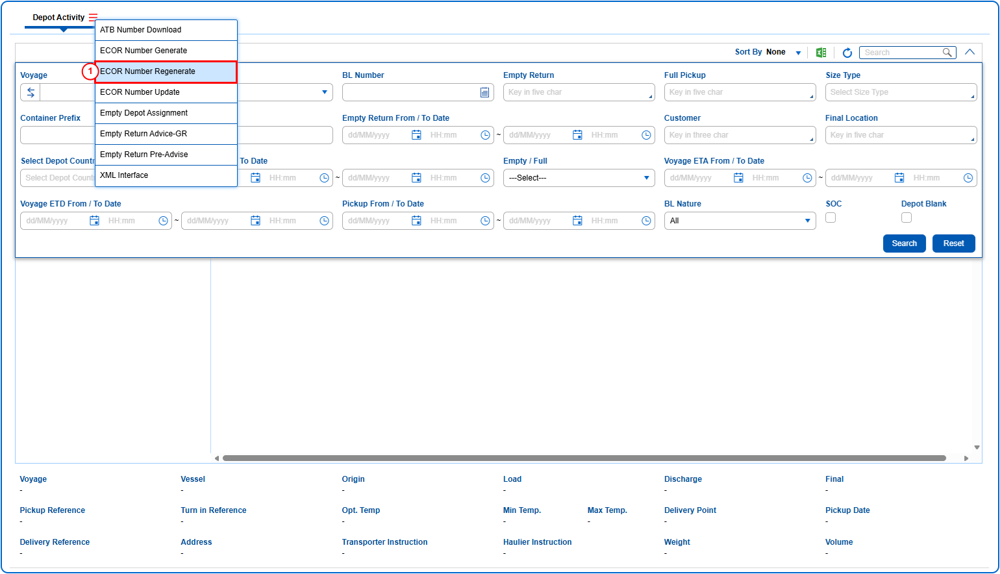
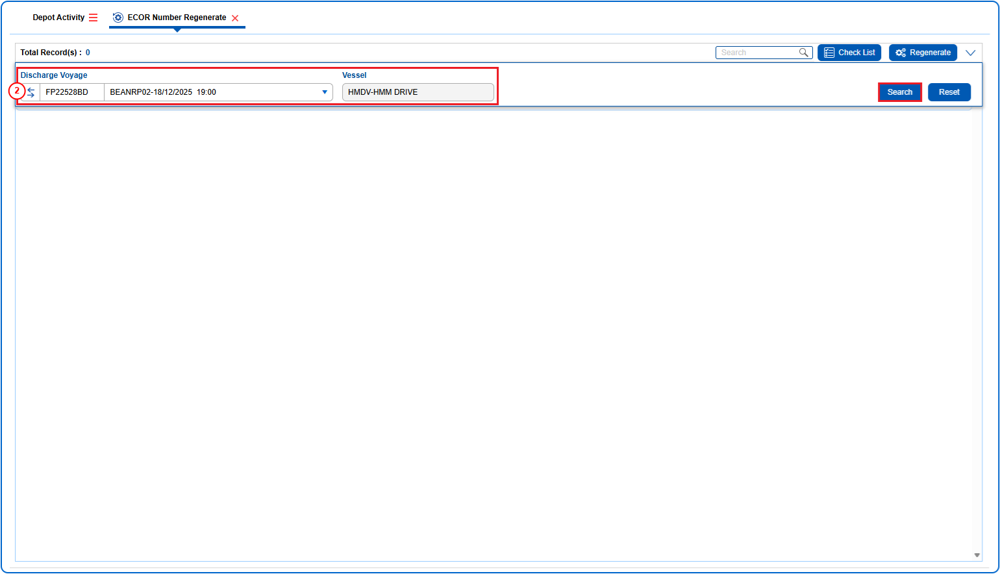
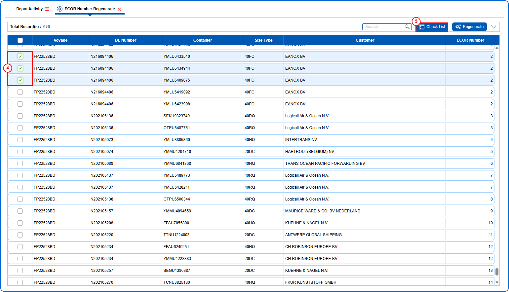
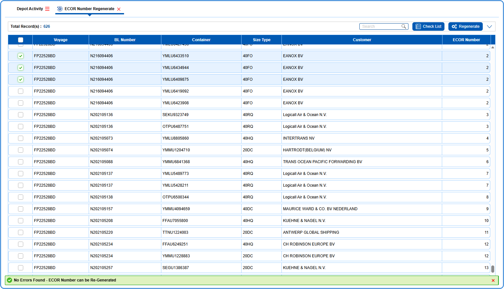
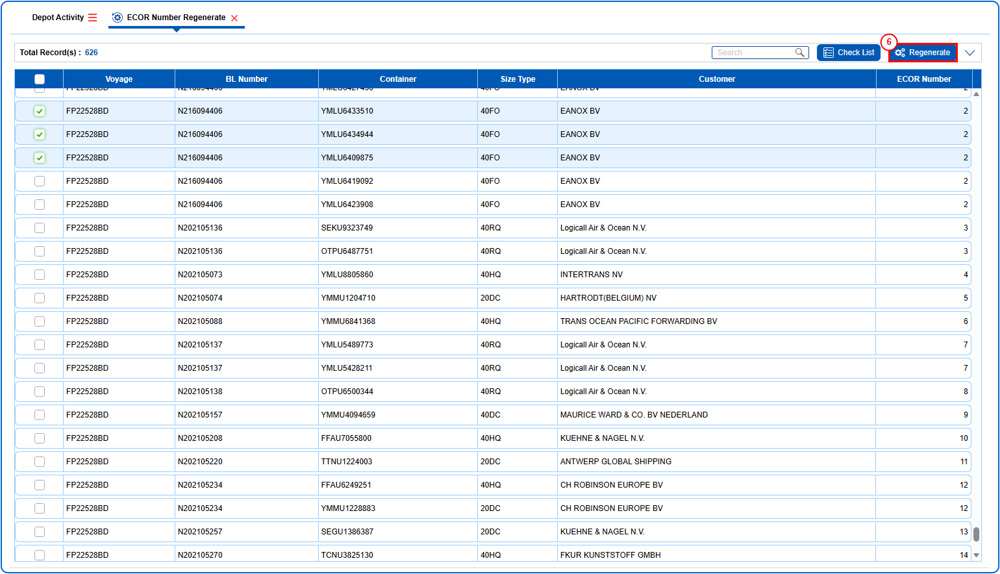
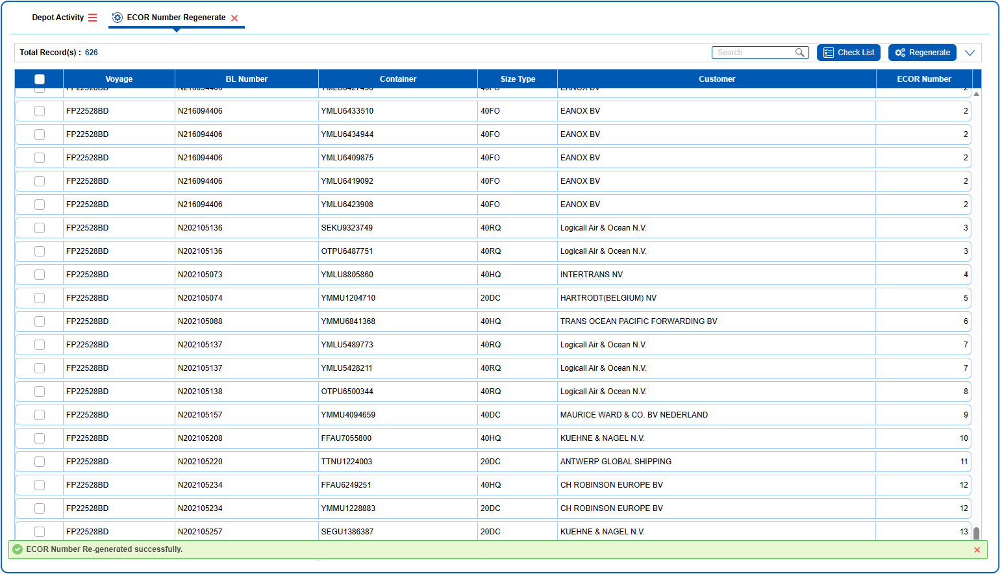

## Steps
**Step 1:** Click on the {img:img/How_to_Regenerate_ECOR_Number_c424_01.png} icon (Voyage level) and select **ECOR Number Regenerate** function from the menu. This will open the ECOR Number Regenerate screen.

**Step 2:** In the ECOR Number Regenerate query screen, Enter the required query parameters in the search fields and click on {img:img/How_to_Regenerate_ECOR_Number_c424_03.png}.

**Step 3:** Upon clicking {img:img/How_to_Regenerate_ECOR_Number_c424_05.png}, records matching the entered criteria will be returned in the data grid.
**Step 4:** Select the desirable record(s) by either clicking on {img:img/How_to_Regenerate_ECOR_Number_c424_06.png} select all checkbox or {img:img/How_to_Regenerate_ECOR_Number_c424_07.png} individual selection checkbox of the respective records.
**Step 5:** Click on {img:img/How_to_Regenerate_ECOR_Number_c424_08.png}.

If Checklist is processed without errors, a success message is displayed.

Step 6: Click on {img:img/How_to_Regenerate_ECOR_Number_c424_11.png}.

If Regenerated successfully, a success message is displayed.
>> 
