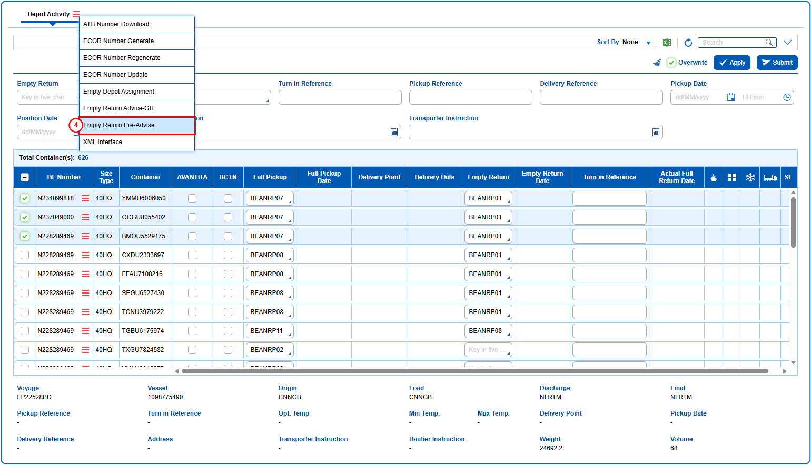
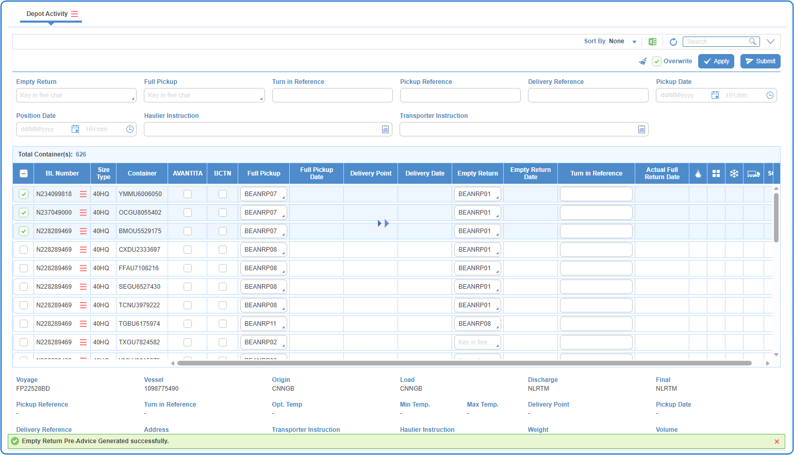

## Pre defined conditions

@11 Empty Return Location cannot be  null.

## Steps
**Step 1:** Enter the required query parameters in the search fields and click on {img:img/How_to_Generate_Empty_Return_Pre_Advise_07fd_01.png}.
**Step 2:** Upon clicking {img:img/How_to_Generate_Empty_Return_Pre_Advise_07fd_02.png}, BL records matching the entered criteria will be returned in the data grid.
**Step 3:** Select the desirable record(s) by either clicking on {img:img/How_to_Generate_Empty_Return_Pre_Advise_07fd_03.png} select all checkbox or {img:img/How_to_Generate_Empty_Return_Pre_Advise_07fd_04.png} individual selection individual selection checkbox of the respective BL.
**Step 4:** Click on the {img:img/How_to_Generate_Empty_Return_Pre_Advise_07fd_05.png} icon (Voyage level) and then select **Empty Return Pre-Advise** function from the menu. This will open the **Empty Return Pre-Advise** screen.

If process is successful, a success message is shown as given below.
>> 
