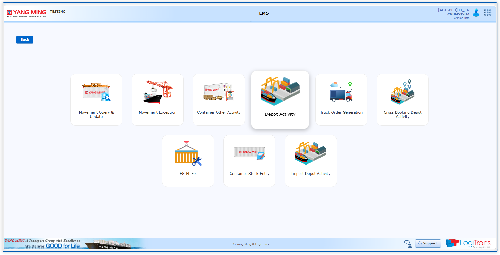
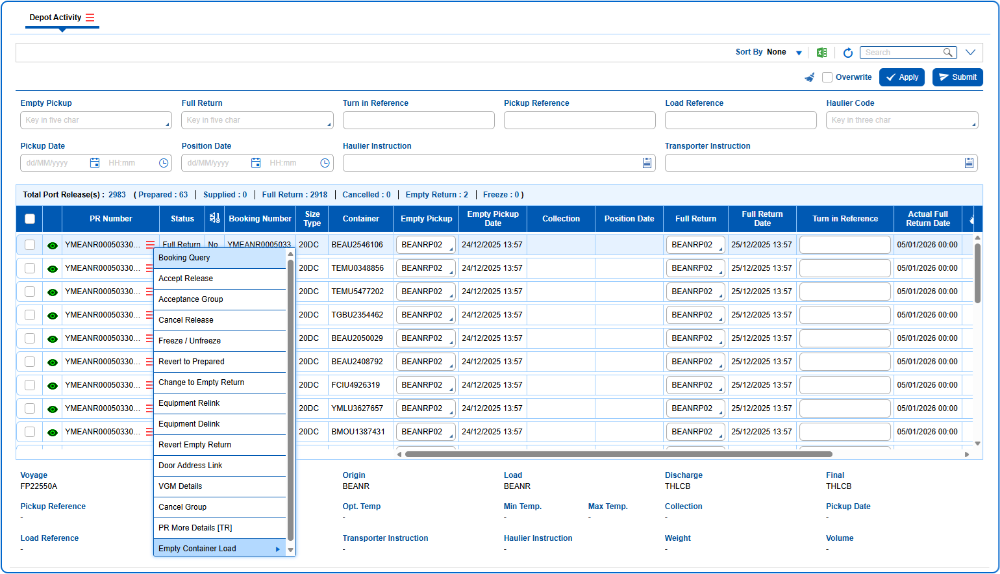
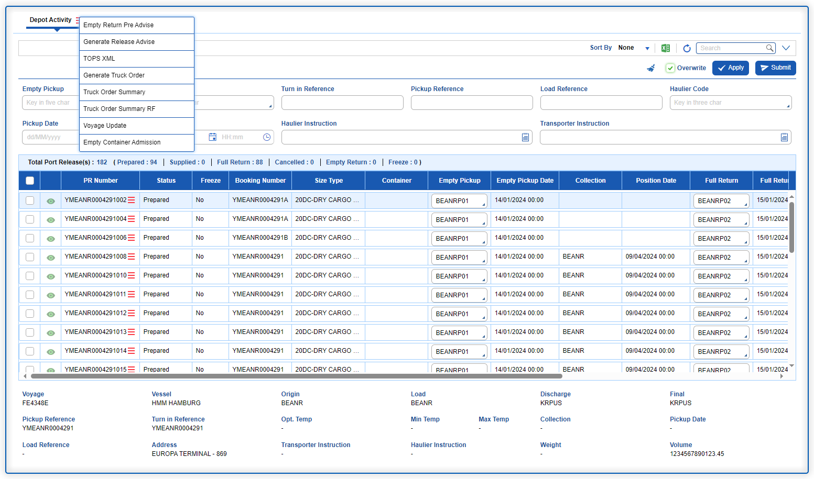

This option is used to update Empty Pickup/Full Return Depot details against booking.
This option allows user can assign Empty Pickup/Full Return Depot/Turn in Reference.

Depot Activity has the following **Single Functions**.
    1.

Depot Activity has the following **Group Functions**.

1. Empty Return Pre Advise
1. Generate Release Advise
1. TOPS XML
1. Generate Truck Order
1. Truck Order Summary
1. Truck Order Summary RF
1. Voyage Update
1. Empty Container Admission
1.

