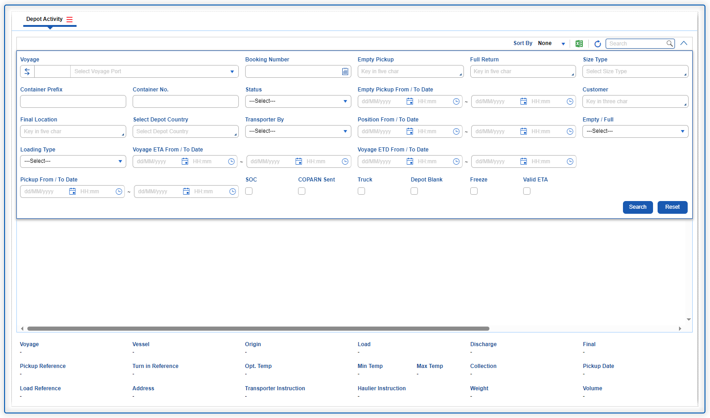

@11 The Query Fields of Depot Activity allows the user to query depot activity data as per requirement.

@11 {img:img/Depot_Activity_Query_Fields_94bc_02.png}- This button allows the user to query data by entering data in fields.
@11 {img:img/Depot_Activity_Query_Fields_94bc_03.png}- This button allows the user to clear multiple fields at once to query with new data, if required.
