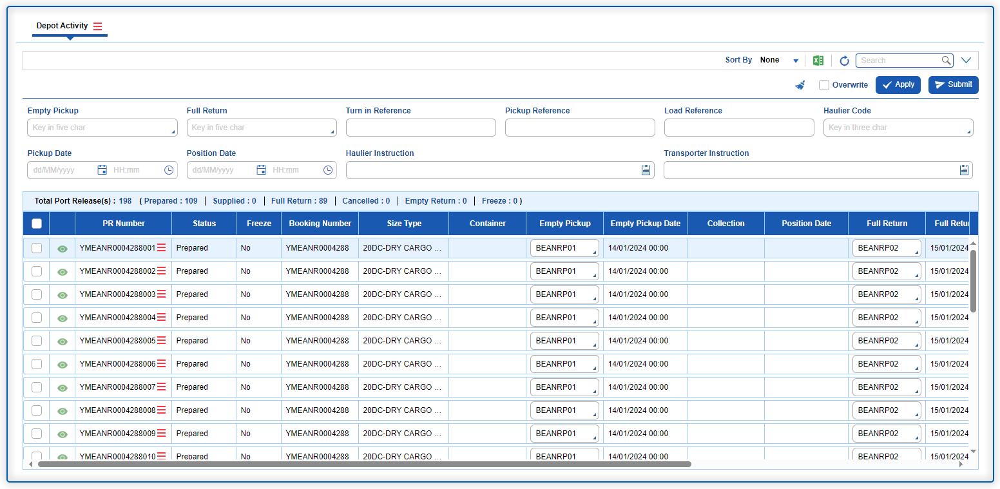
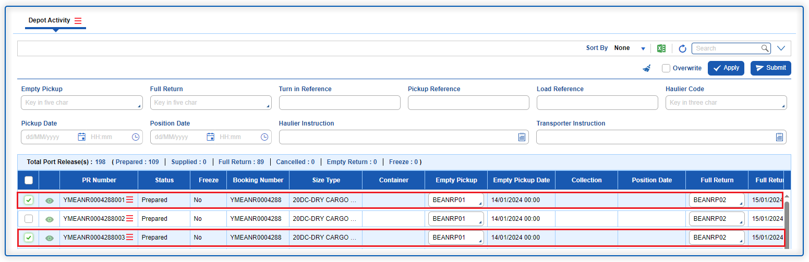
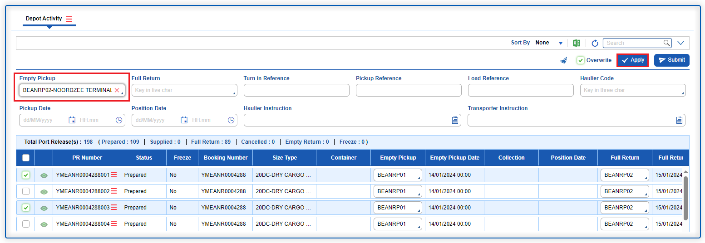
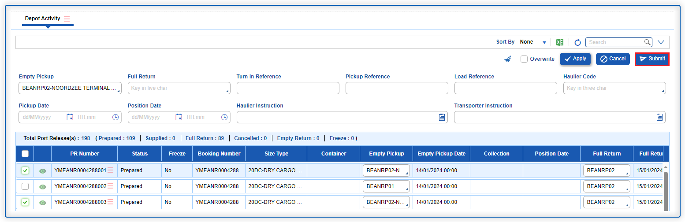
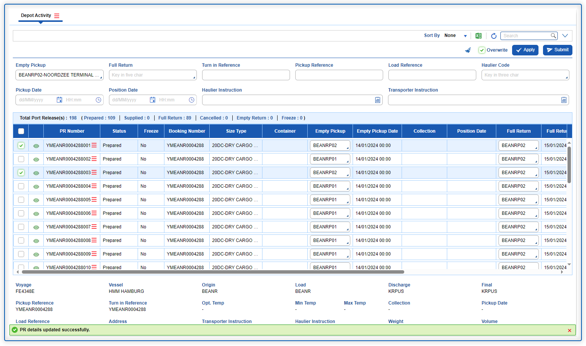

**Step 1** : The user should query depot activity data using depot activity query fields.

**Step 2** : The user should then select the records where the user wants to change data.

**Step 3** : After the user selects data the user should enter desired data in the Edit fields as highlighted below and click on {img:img/How_to_Change_Empty_Return_Full_Return_Edit_Fields_0d2b_03.png} checkbox to over write old data with new data.
    1.
    1. After that the user has 3 options

    1. {img:img/How_to_Change_Empty_Return_Full_Return_Edit_Fields_0d2b_04.png}- This button allows the user to preview the new data before actually submitting it
    1.
    1. {img:img/How_to_Change_Empty_Return_Full_Return_Edit_Fields_0d2b_05.png}- This button allows the user to cancel the change from old data to new data
    1.
    1. {img:img/How_to_Change_Empty_Return_Full_Return_Edit_Fields_0d2b_06.png}- This button allows the user to submit the new data.

    1.

**Step 4** : If the process is successful the user is shown a success message as shown below.

    1.
