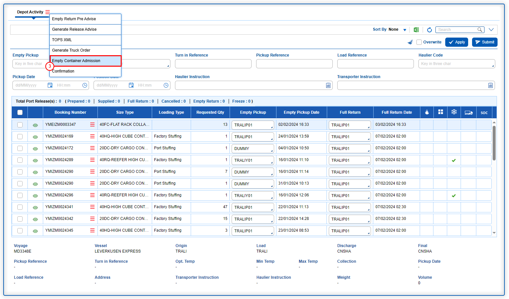
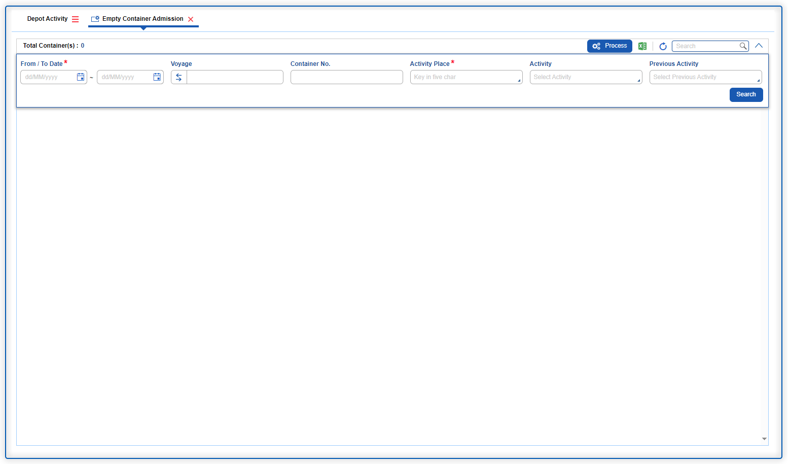
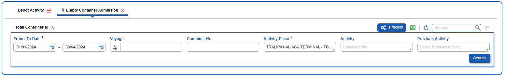
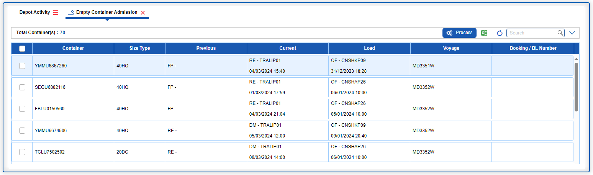
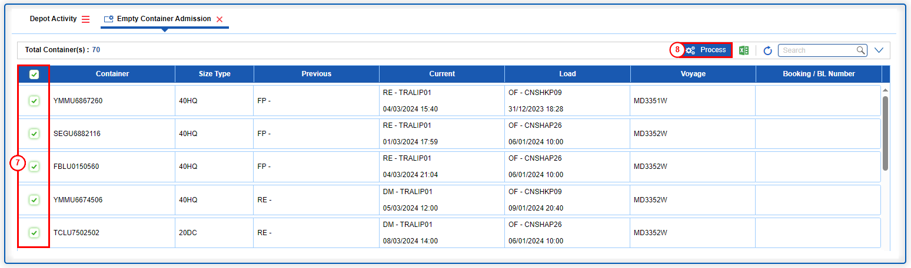
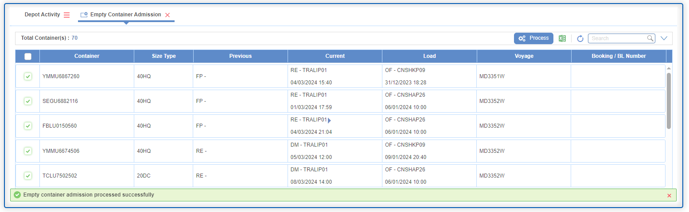

## Pre defined conditions

@11 Last activity should be DE / RE / EA
@11 Previous Activity should be OE or OF

## Steps

1. **Step 1** : The user should query data using the query fields.
**Step 2** : The user should the click on the Menu icon near depot activity and this opens a drop down menu with a list of Group functions
**Step 3** : The user should then click on "**Empty Container Admission**".

**Step 4** : On clicking &D**Empty Container Admission&D** from the menu, the user will be taken to Empty Container Admission screen.

**Step 5:** The user should enter data in the query fields as shown below.

**Step 6** : The data is queried based on information given in the query fields.
>> 

1. **Step 7 :** The user can select on desirable records by clicking on respective checkboxes
    1. **Note** **:** The user can select one or many container at a time.
**Step 8 :** Once the user has selected the records, the user click on **&DProcess&D** button**.**

If process is successful, a success message is shown as given below.

