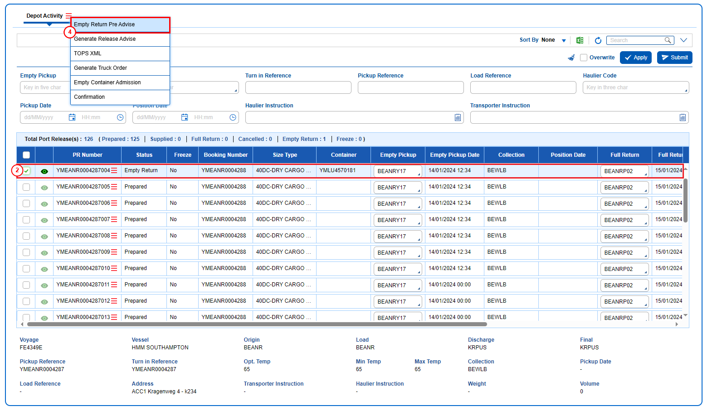
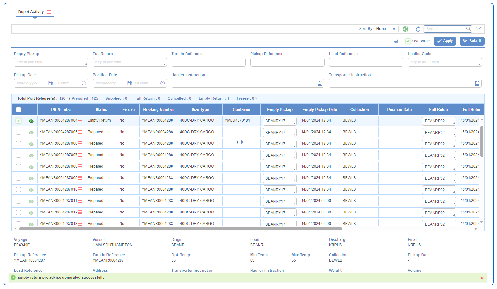

## Pre defined conditions

@11 Selected PR container should not be in Prepared, Cancelled or Freeze status.

## Steps

**Step 1** : The user should query data using the query fields.
**Step 2** : The user should then click on the checkboxes to select required bookings from queried bookings.
1.   **Note** **:** The user can select one or many bookings at a time to generate Empty Return Pre Advise.
**Step 3** : The user should the click on the Menu icon near depot activity and this opens a drop down menu with a list of Group functions
**Step 4** : The user should then click on "**Empty Return Pre Advise**".

If process is successful, a success message is shown as given below.
>> 
