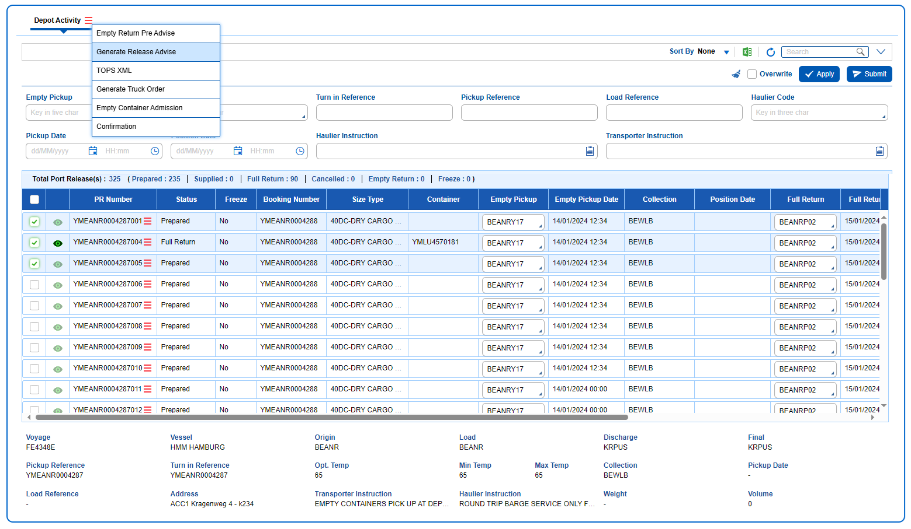

This feature enables the sending of release advice notifications to both the booking customer and the depot address.
The notification is dispatched in advance, allowing for updates to be made to the empty pickup depot, full return depot, and turn-in reference values if needed.
Once these changes are made, notifications are sent either via Right Fax or email.

