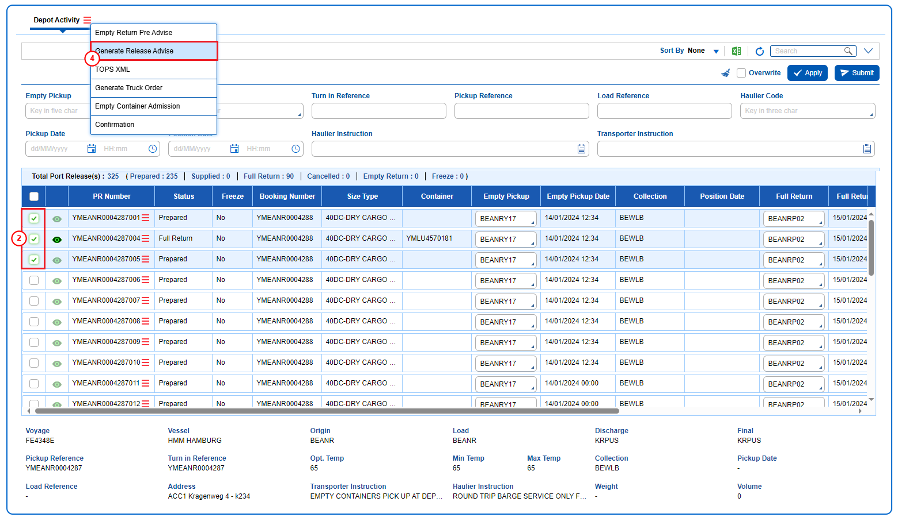
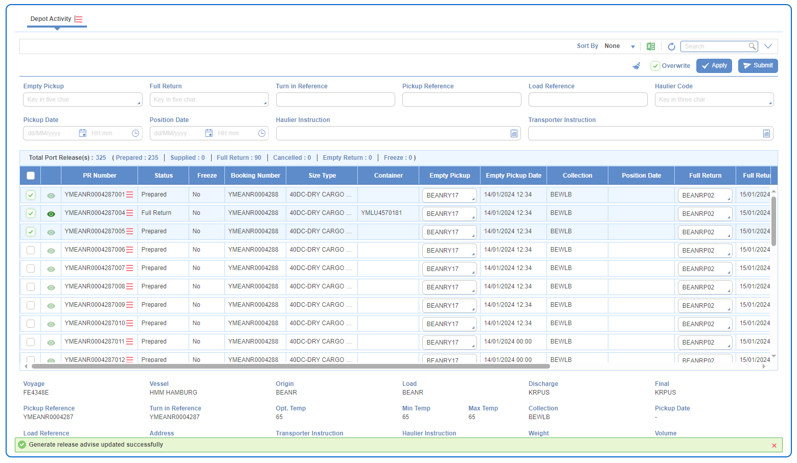

## Pre defined conditions

Port release should be generated, and the release advice will be generated based on whether the container is accepted or not.
Both booking and PR information should be available.

## Steps

**Step 1** : The user should query data using the query fields.
**Step 2** : The user should then click on the checkboxes to select required bookings from queried bookings.
1.   **Note** **:** The user can select one or many bookings at a time to generate Generate Release Advise.
**Step 3** : The user should the click on the Menu icon near depot activity and this opens a drop down menu with a list of Group functions
**Step 4** : The user should then click on "**Generate Release Advise**".

If process is successful, a success message is shown as given below.
>> 
