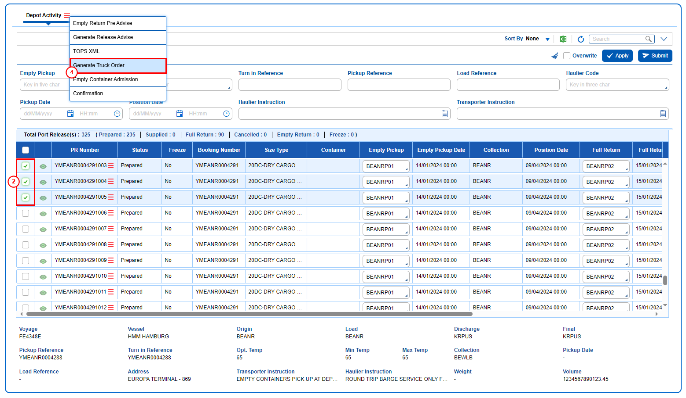
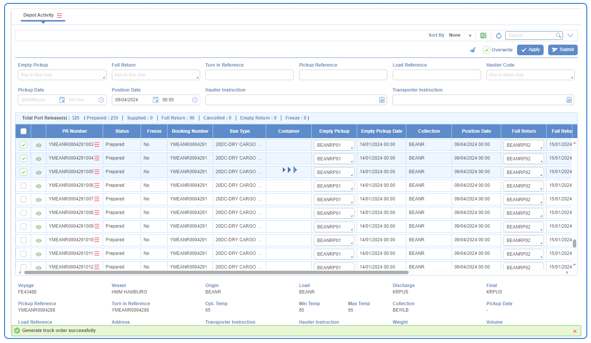

## Pre defined conditions

1. When **Haulage information** cargo common is available for the PR and its value is &#x2018;**N**&#x2019; then **Transporter mode** should be &#x2018;**C-Carrier**&#x2019;.
1. Position date cannot be blank.
1. Pickup date cannot be blank.
1. Rightfax record is inserted with **right fax type** as &D**TRUCK_ORDER**&D. The communication is got from Transporter master for the Haulier code (Email or Fax).
1.  PR should have been generated for the Booking.
1.  For **agency not in &DESCDM&D or &DCRAGS&D** and **AFSYS_TRK_ORD_QRY_CRITRIA_REQ config is set**, then **query the PR only when its linked to a valid mode.**
1. For a**gency not in &DESCDM&D or &DCRAGS&D** and **AFSYS_TRK_ORD_QRY_CRITRIA_REQ** config is set, then **query the PR only on below said conditions**.
    1. If **container is available then Container seal should exists**, the only PR can query.
    1. When **Transport mode** is **&#x2018;Not Applicable&#x2019;** and **&#x2018;HAULAGE_INFO&#x2019; cargo common available for the booking** then only PR can query.
    1. When **Transport mode is Blank** and **&#x2018;HAULAGE_INFO&#x2019; cargo common available for the booking** then only PR can query,
    1. When **Transport mode parameter is set as &#x2018;Not Applicable&#x2019;** and **Truck check box in parameter is set as Y** then if **PL&#x2019;s Transport mode is &#x2018;Truck round trip&#x2019;** and **address is not linked to PR** then only PR can query.
    1. When **Transport mode parameter is set as &#x2018;Not Applicable&#x2019;** and **Truck check box in parameter is set as N** then if **PL&#x2019;s Transport mode is &#x2018;Truck round trip&#x2019;** and **address is linked to PR** then only PR can query.
    1. When **Transport mode parameter is set as &#x2018;Truck Round Trip&#x2019;** and **Truck check box in parameter is set as N** then if **PL&#x2019;s Transport mode is &#x2018;Not Appicable&#x2019;** and **address is not linked to PR** then only PR can query.
    1. When **Transport mode parameter is set as &#x2018;Truck Round Trip&#x2019;** and **Truck check box in parameter is set as Y** then if **PL&#x2019;s Transport mode is &#x2018;Not Appicable&#x2019;** and **address is linked to PR** then only PR can query.
    1. When **Transport mode parameter is set as Blank** and **Truck check box in parameter is set as N** then if **PL&#x2019;s Transport mode is either of &DNot Applicable&D/&DTruck round trip&D** and **address is not linked to PR** then only PR can query.
    1. When **Transport mode parameter is set as Blank** and **Truck check box in parameter is set as Y** then if **PL&#x2019;s Transport mode is either of &DNot Applicable&D/&DTruck round trip&D** and **address is  linked to PR** then only PR can query.

## Steps

**Step 1** : The user should query data using the query fields.
**Step 2** : The user should then click on the checkboxes to select required bookings from queried bookings.
1.   **Note** **:** The user can select one or many bookings at a time to generate Generate Truck Order.
**Step 3** : The user should the click on the Menu icon near depot activity and this opens a drop down menu with a list of Group functions
**Step 4** : The user should then click on "**Generate Truck Order**".

If process is successful, a success message is shown as given below.
>> 
