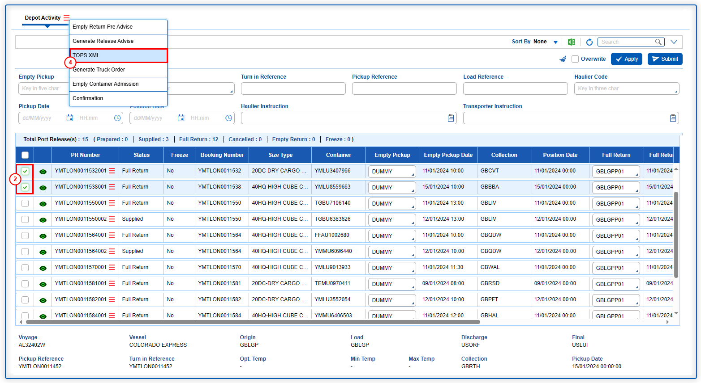

This feature generates the TOPS XML Interface, specifically utilized by locations in the UK.
The TOPS XML interface is generated when the container position date is available for the PR/container.

