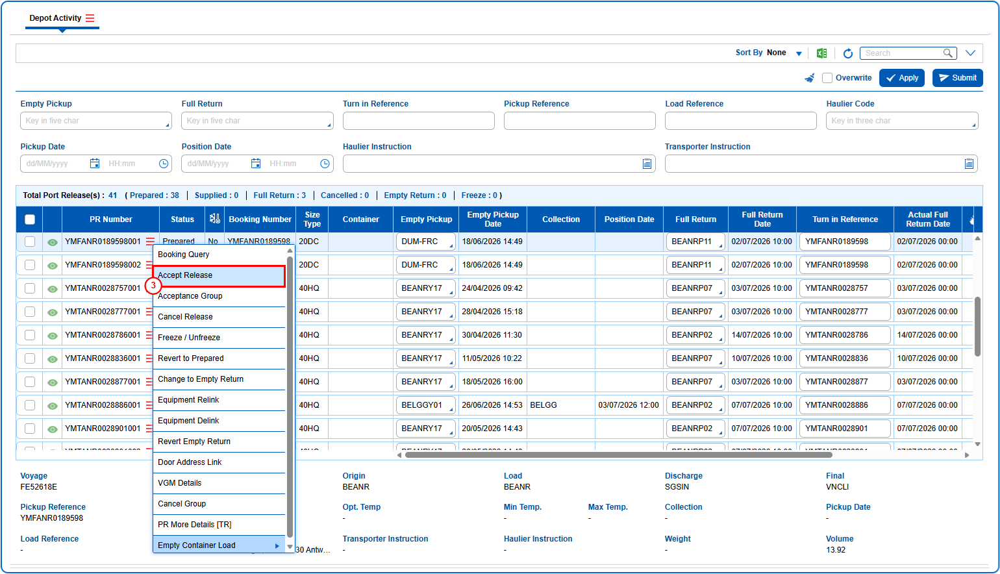
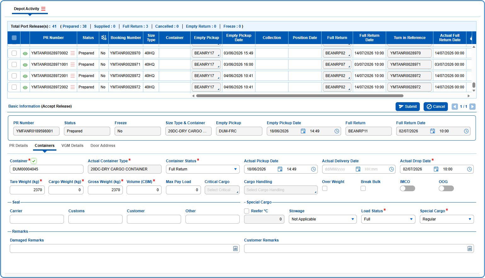
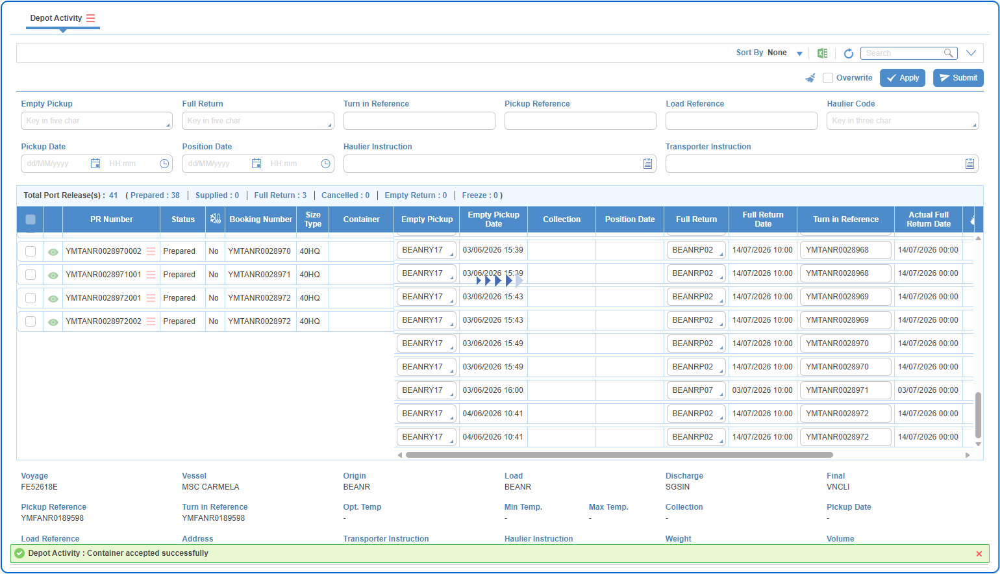
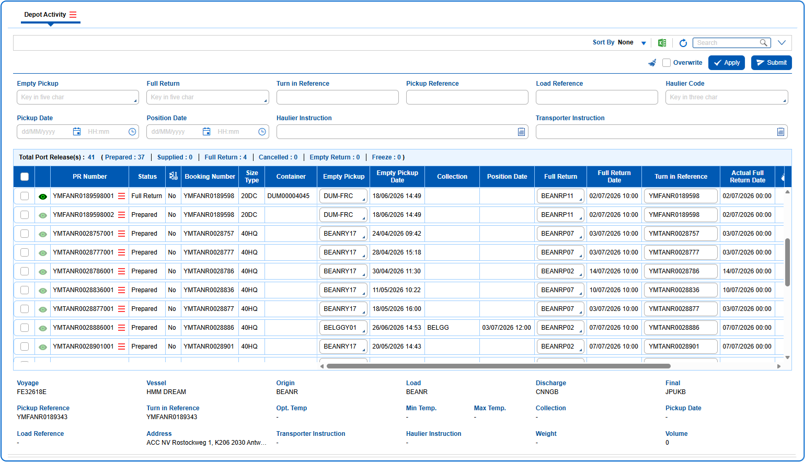

## Pre defined conditions

PR Status must be in "**Prepared**" status.

## Steps

1. **Step 1** : The user should query data using the query fields.
**Step 2** : The user should the click on the Menu icon near the desired PR Number and this opens a drop down menu with a list of single functions.
**Step 3** : The user should then click on "**Accept Release**".

**Step 4** : On clicking &D**Accept Release&D** from the menu, the user will be taken to Accept Release- Container section will be displayed in the same tab.
**Step 5** : The user should fill in container number in the &D**Container**&D field which will auto populate all other required fields({img:img/How_to_Accept_PR_Release_07c5_02.png}) if information is available or the user can enter data manually.
**Step 6** : Once the user has entered the required details, the user should click on the &D**Submit**&D Button to save container details.

If process is successful, a success message is shown as given below and &D**Status**&D is changed into &D**Full Return**&D or &D**Empty Return**&D or &D**Supplied**&D

