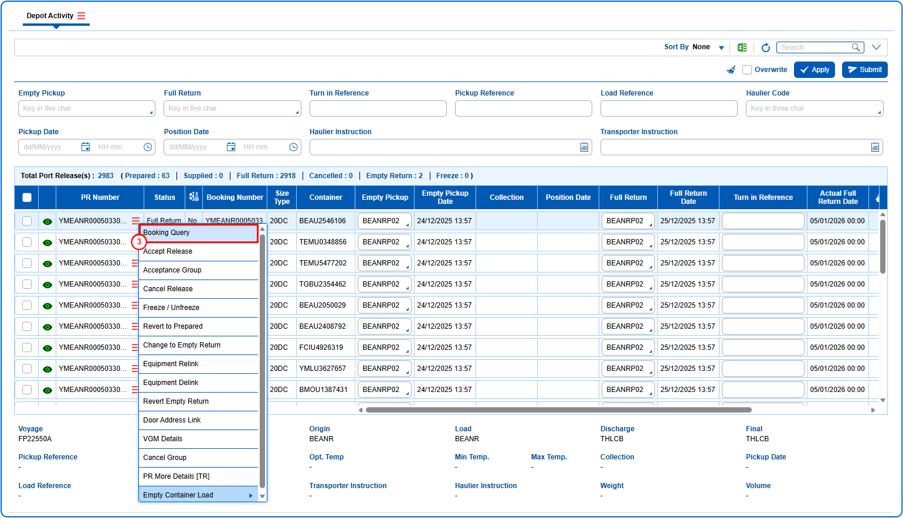
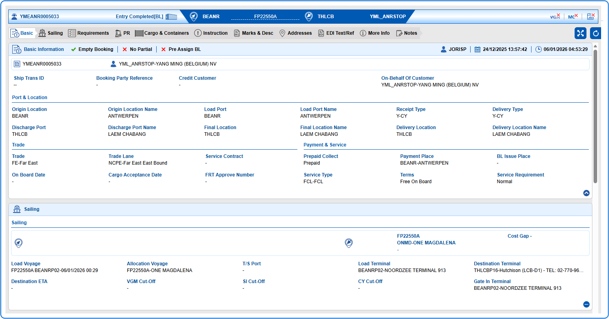

## Steps

1. **Step 1** : The user should query data using the query fields.
**Step 2** : The user should the click on the Menu icon near the desired PR Number and this opens a drop down menu with a list of single functions.
**Step 3** : The user should then click on "**Booking Query**".

**Step 4** : On clicking &D**Booking Query&D** from the menu, the user will be taken to Booking Query screen in a new tab.

{img:img/How_to_view_Booking_Details_using_Booking_Query_e078_03.png}
The above given bar allows the user to jump across various sections without having to scroll down manually.

{img:img/How_to_view_Booking_Details_using_Booking_Query_e078_04.png} **-** This icon allows the user to expand all sections in booking query screen at once.

{img:img/How_to_view_Booking_Details_using_Booking_Query_e078_05.png} **-** This icon allows the user to collapse all sections in booking query screen at once.

{img:img/How_to_view_Booking_Details_using_Booking_Query_e078_06.png} **-** This icon allows the user to refresh Booking Query Screen.

{img:img/How_to_view_Booking_Details_using_Booking_Query_e078_07.png} **-** This icon allows the user to collapse a particular section where this icon is displayed.

{img:img/How_to_view_Booking_Details_using_Booking_Query_e078_08.png}-This icon allows the user to expand a particular section where this icon is displayed.
