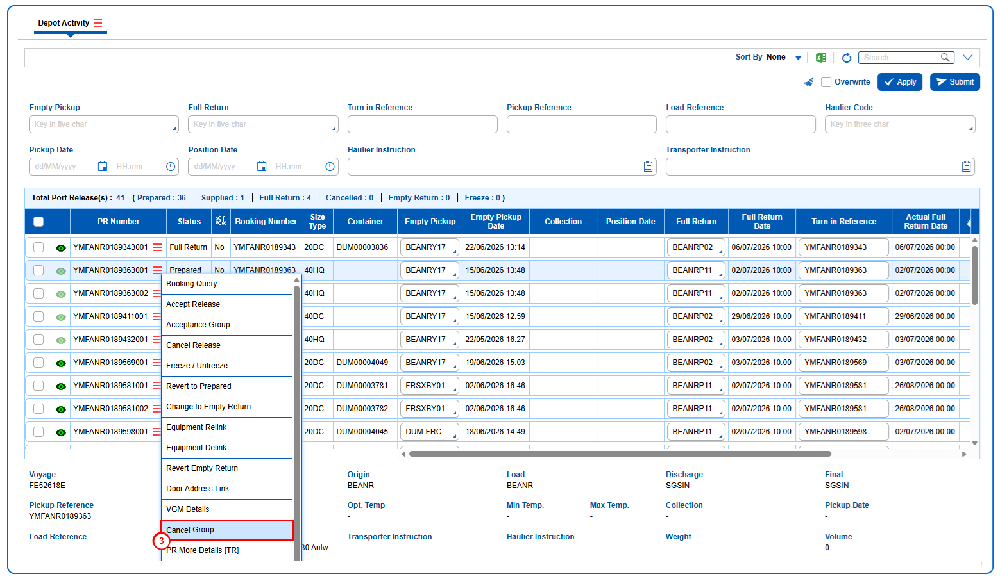
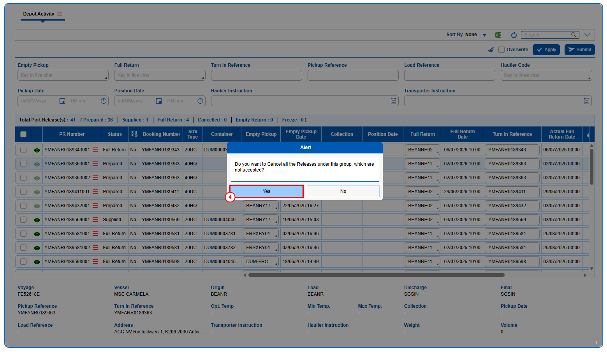
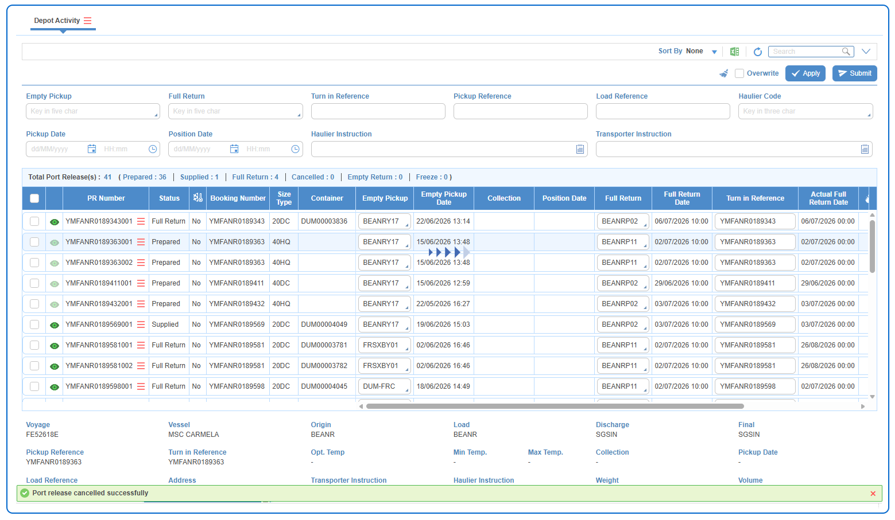

## Pre defined conditions

@11 Booking Status should be Entered or Completed.
@11 PR status should be Prepared Or Supplied status.
@11 Already PR has been transferred to TOPS or PR Key linked with Address , Cancel PR release will not be allowed.

## Steps

1. **Step 1** : The user should query data using the query fields.
**Step 2** : The user should the click on the Menu icon near the desired PR Number and this opens a drop down menu with a list of single functions.
**Step 3** : The user should then click on "**Cancel Group**".

**Step 4** : On clicking &D**Cancel Group&D** from the menu, the user will be displayed a message as shown below.Click on &D**Yes**&D to cancel PR.

If process is successful, a success message is shown as given below.

>>  o
