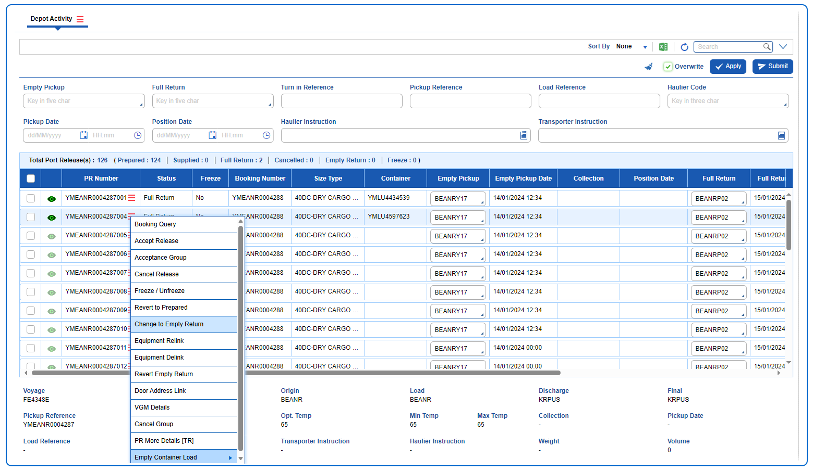

Sometimes detention charges are applicable to containers returned by customer which are already released to them, the user can use "Change To Empty Return" to convert container to empty return status and calculate these charges.

