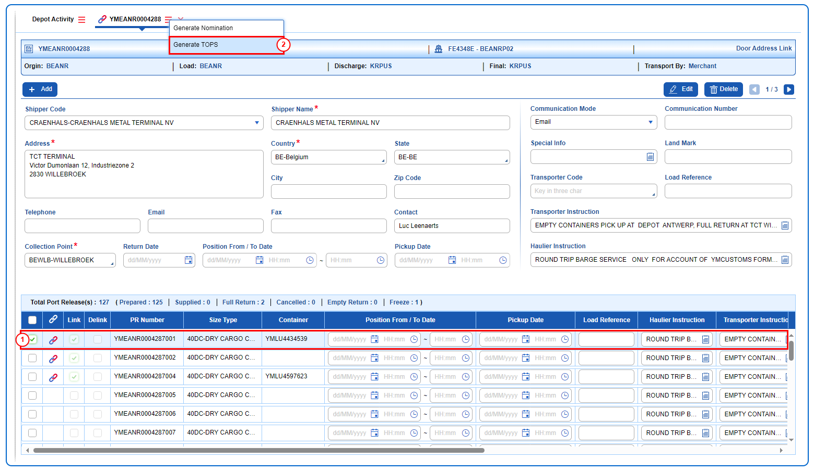
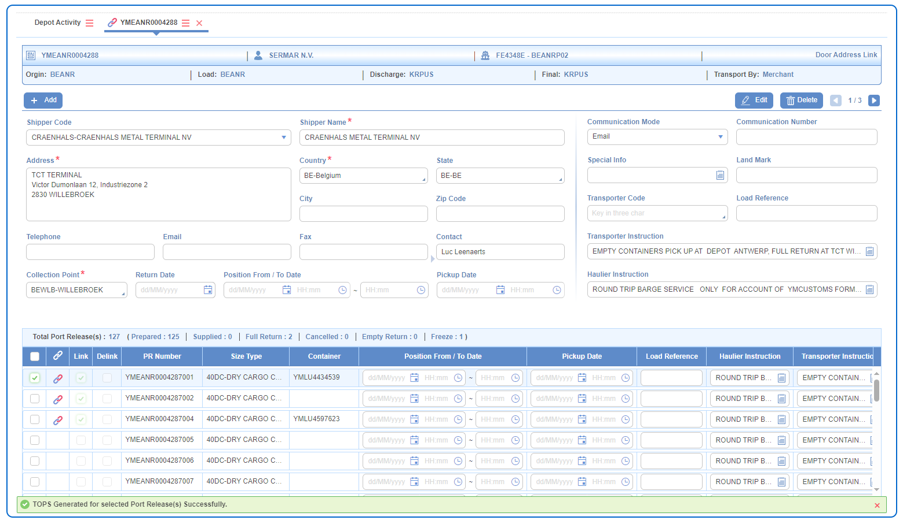

## Pre defined conditions

The Booking to be saved with one or more Requirement Details.
The Booking status be in Entered Status or Entry Complete Status.

## Steps

**Step 1** : To generate TOPS, The user should select records by clicking on check boxes of respective records.
**Step 2** : Once the user has selected the records, The user should click "**Generate TOPS**" as shown below.

If process is successful, a success message is shown as given below.
>>  o
