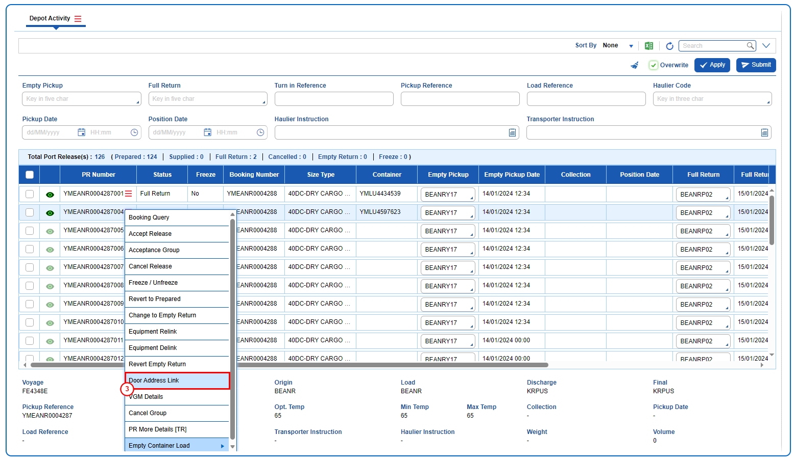
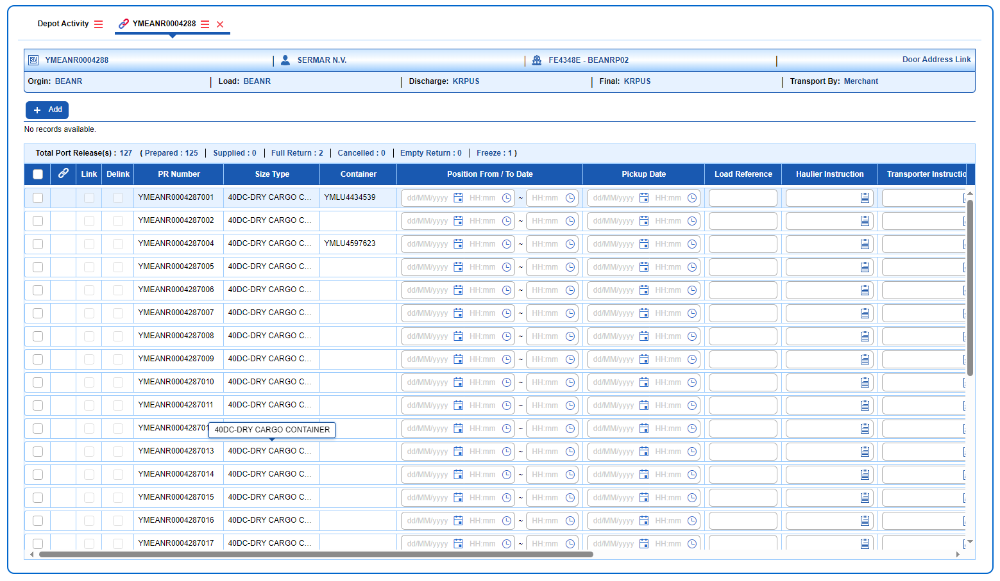
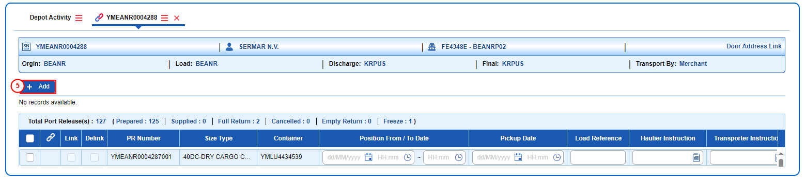
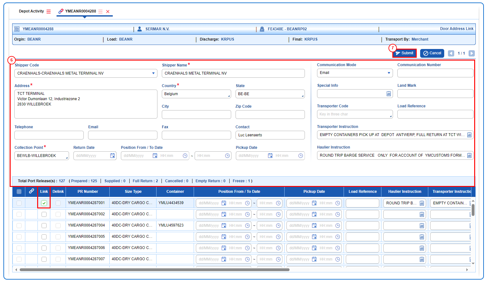
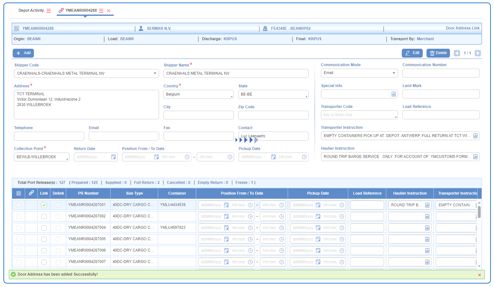
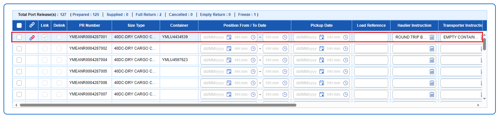

## Pre defined conditions

The Booking to be saved with one or more Requirement Details.
The Booking status be in Entered Status or Entry Complete Status.
@11 When config ADDRESS_LINK_FOR_NON_DOOR_REQ is set as Y then Valid PR with status other than cancelled should exist
@11 When config ADDRESS_LINK_FOR_NON_DOOR_REQ is set as N then Valid PR with status other than cancelled should exist and also Transport by to be C - Carrier

## Steps

1. **Step 1** : The user should query data using the query fields.
**Step 2** : The user should the click on the Menu icon near the desired PR Number and this opens a drop down menu with a list of single functions.
**Step 3** : The user should then click on "**Door Address Link**".

**Step 4** : On clicking &D**Door Address Link&D** from the menu, the user will be taken to Door Address Link screen in a new tab.

**Step 5** : The user should click on "**Add**" button, which displays Address field.
**Step 6** : The user should enter necessary details in the fields and select required records (to be linked) by clicking on checkboxes in Link column.
**Step 7** : Once the user has clicked the checkboxes, the user should click on "**Submit**" to link Door Address to PR Number.

If process is successful, a success message is shown and link column is disabled and  {img:img/How_to_Link_door_address_to_PR_421c_05.png}  is shown indicating that the door address is linked as given below.

