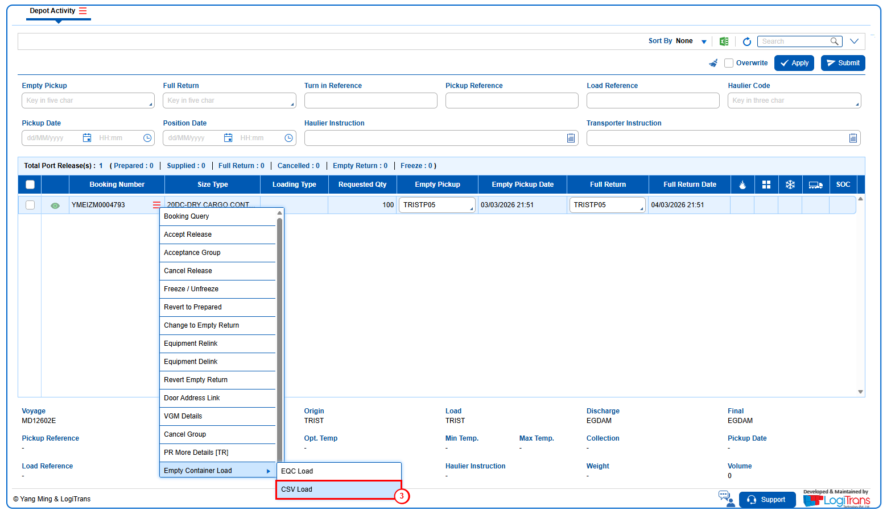
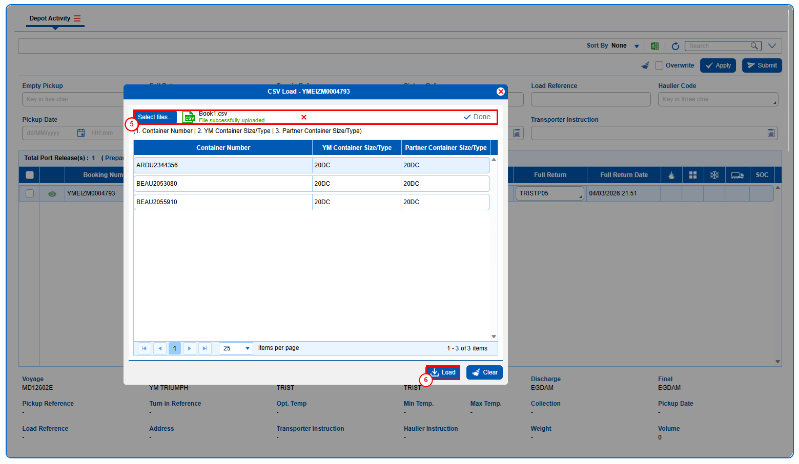
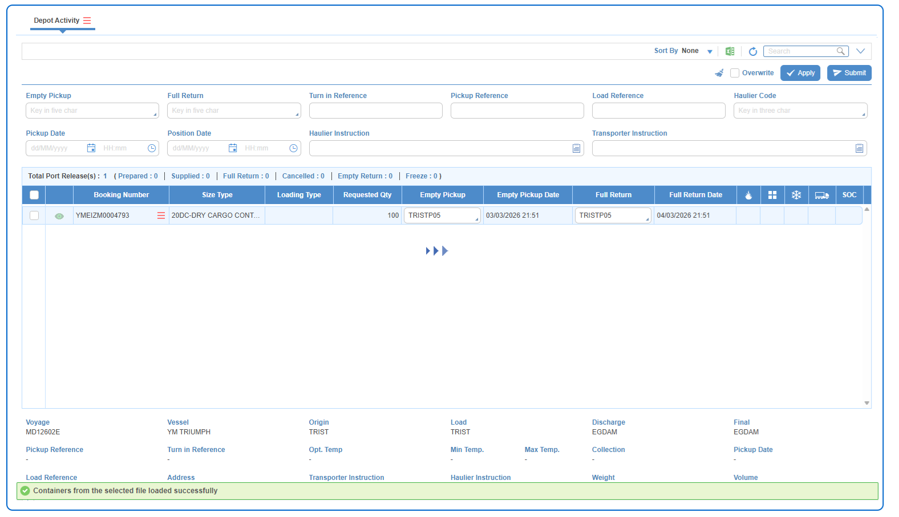

## Steps

1. **Step 1** : The user should query data using the query fields.
**Step 2** : The user should the click on the Menu icon near the desired PR Number and this opens a drop down menu with a list of single functions.
**Step 3** : The user should then click on "**Empty Container Load**">>"**EQC Load**".

**Step 4** : On clicking &D**CSV Load&D** from the menu, the user will be taken to the &D**CSV Load&D** pop up screen.
**Step 5** : Upload file.
**Step 6** : Click on &D**Load**&D

If processed, a success message or error message is shown as given below.

