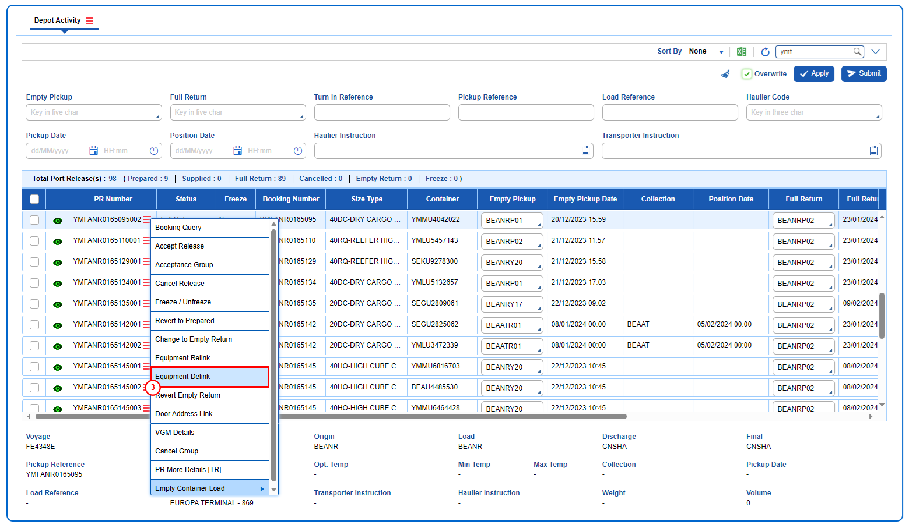
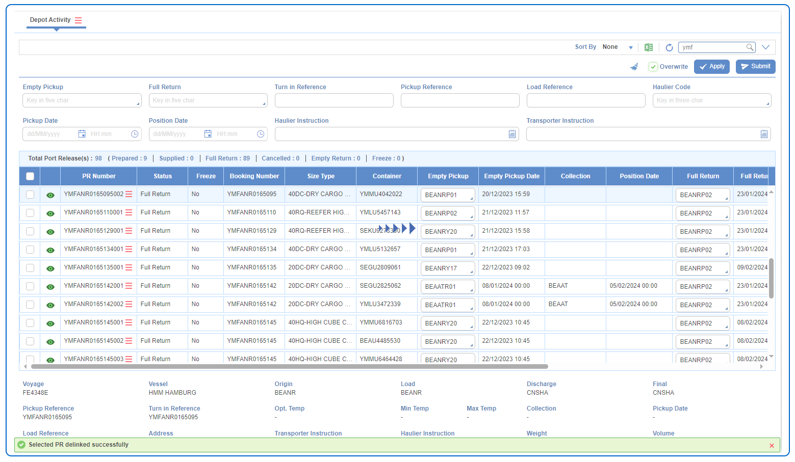

## Pre defined conditions

PR Container should be linked through EQC

## Steps

1. **Step 1** : The user should query data using the query fields.
**Step 2** : The user should the click on the Menu icon near the desired PR Number and this opens a drop down menu with a list of single functions.
**Step 3** : The user should then click on "**Equipment Delink**".

If process is successful, a success message is shown as given below.

>>  
