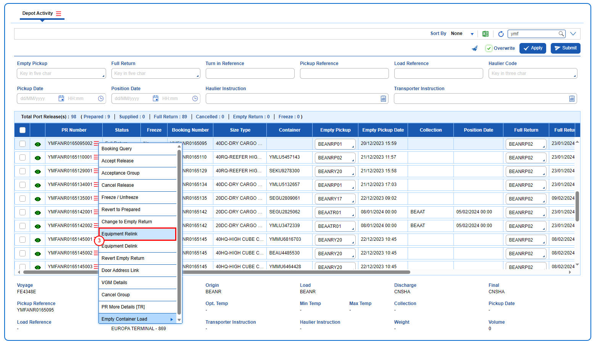
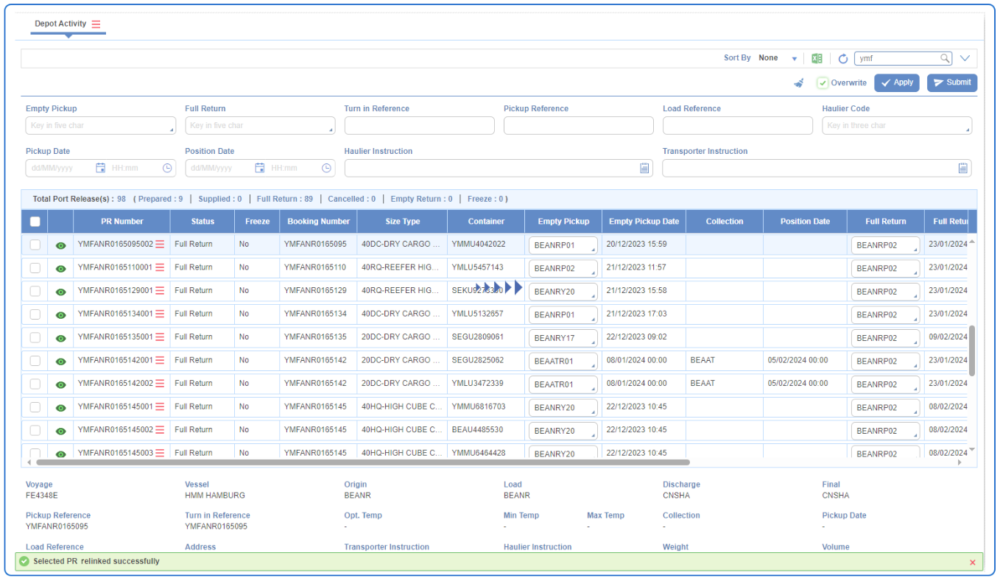

## Pre defined conditions

PR status should be "**Prepared**".
Booking status should be "**Entered**".

## Steps

1. **Step 1** : The user should query data using the query fields.
**Step 2** : The user should the click on the Menu icon near the desired PR Number and this opens a drop down menu with a list of single functions.
**Step 3** : The user should then click on "**Equipment Relink**".

If process is successful, a success message is shown as given below.

>>  
