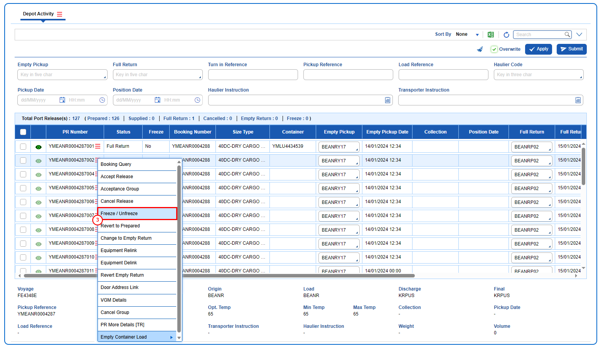
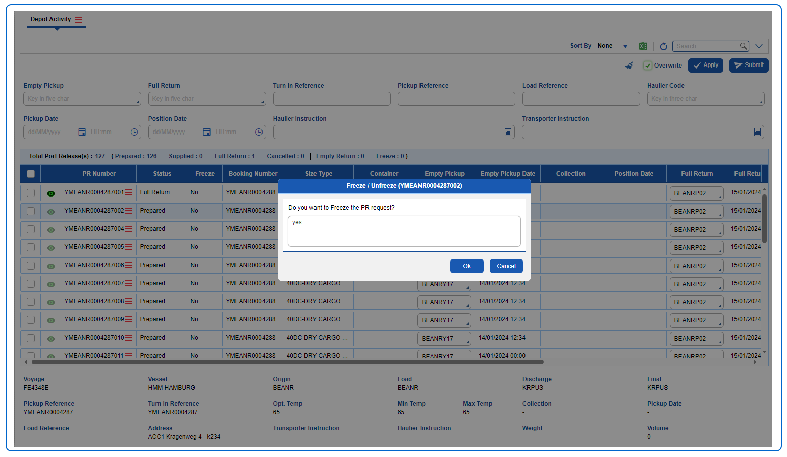
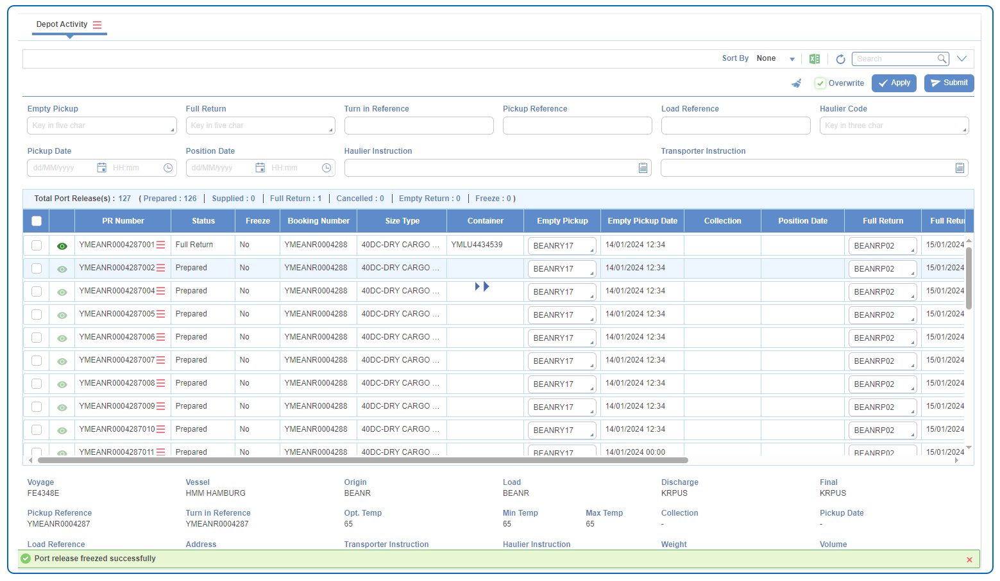
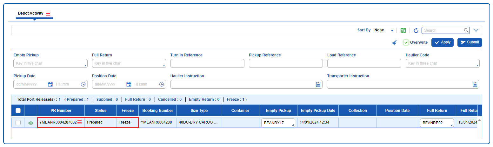
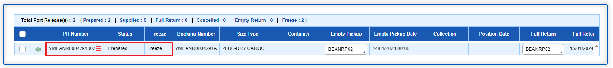
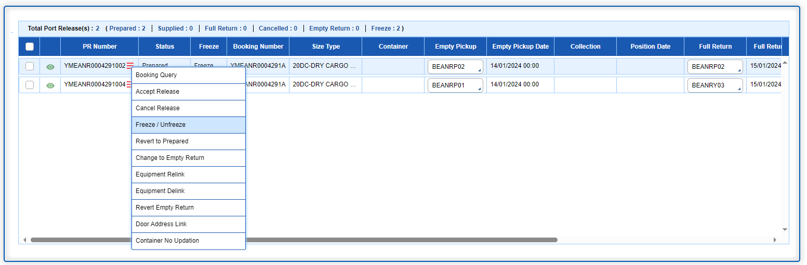
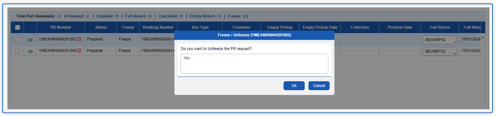
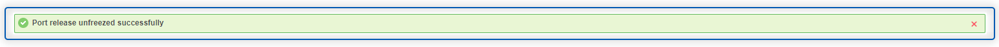
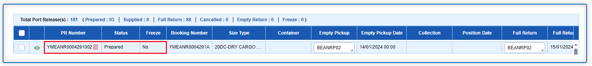

## Pre defined conditions

**For Freeze :** "**Freeze**" column should be "**No**".
**For Unfreeze :** "**Freeze**" column should be "**Freeze**".

## Freeze - Steps

1. **Step 1** : The user should query data using the query fields.
**Step 2** : The user should the click on the Menu icon near the desired PR Number and this opens a drop down menu with a list of single functions.
**Step 3** : The user should then click on "**Freeze / Unfreeze**".

**Step 4** : On clicking &D**Freeze / Unfreeze&D** from the menu, the user will be displayed a message as shown below. The user should type a valid remark and click on &D**Ok**&D to cancel PR.

If process is successful, a success message is shown as given below and &D**Freeze**&D column is changed into &D**Freeze**&D.

>>  

## Unfreeze - Steps

Similarly, the user can use the same steps as given above to unfreeze a booking.

If process is successful, a success message is shown as given below and &D**Freeze**&D column is changed into &D**No**&D.

