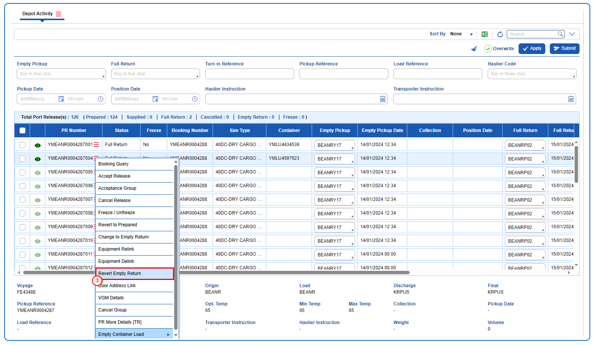
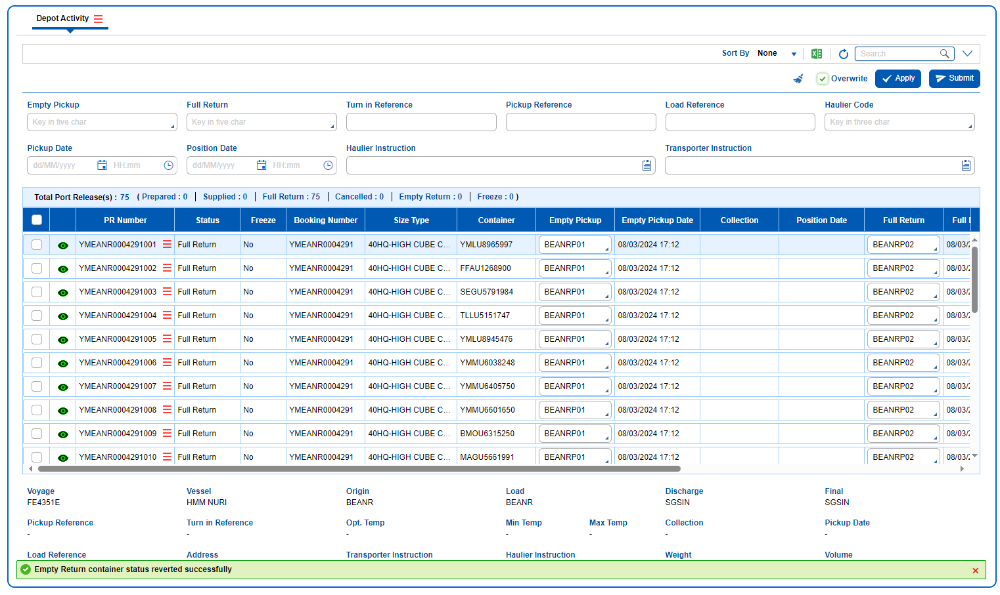
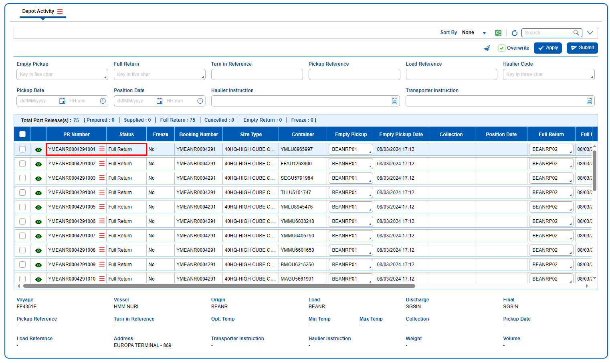

## Pre defined conditions

PR status should be "**Empty Return**".
PR status should not be any other status than **"Empty Return"**
If Container linked to B/L then process will return error, so the user should delink container from B/L.

## Steps

1. **Step 1** : The user should query data using the query fields.
**Step 2** : The user should the click on the Menu icon near the desired PR Number and this opens a drop down menu with a list of single functions.
**Step 3** : The user should then click on "**Revert Empty Return**".

If process is successful, a success message is shown as given below and &D**Status**&D is changed from &D**Empty Return**&D to previous status.
>>  

