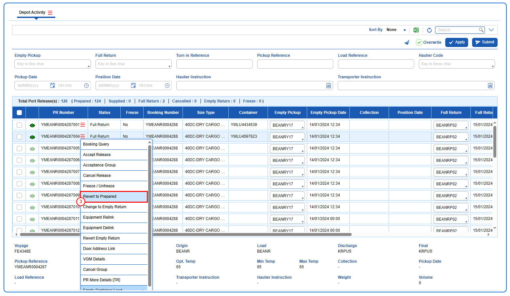
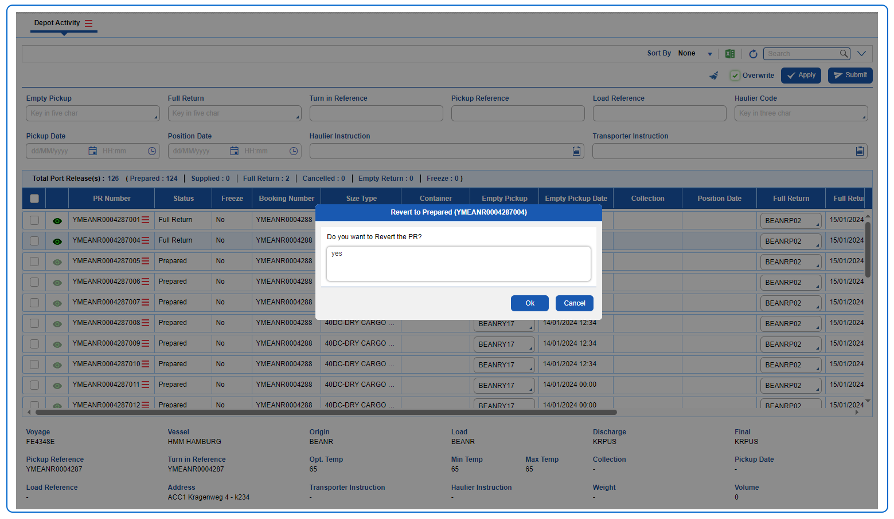
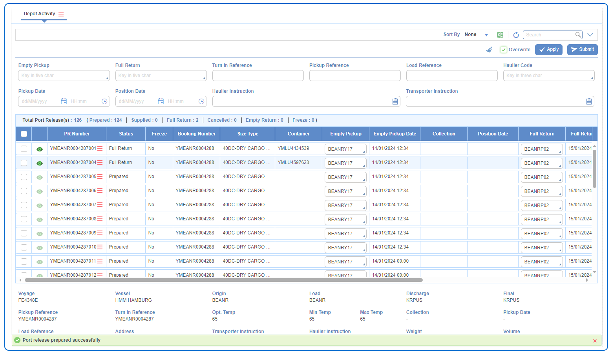
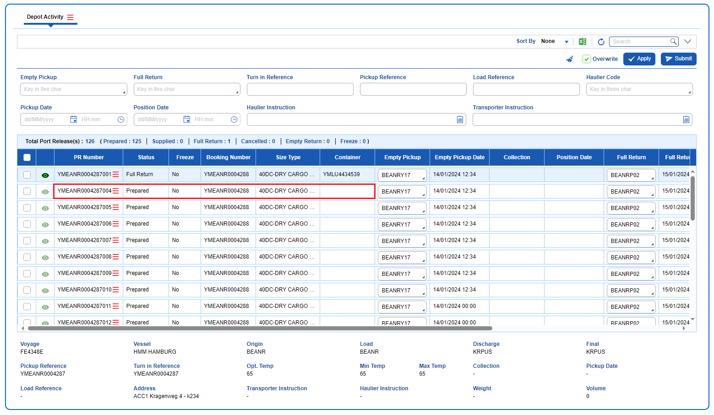

## Pre defined conditions

PR status should be "**Supplied**" or "**Full Return**".
If Container linked to B/L then this option not allowed.

## Steps

1. **Step 1** : The user should query data using the query fields.
**Step 2** : The user should the click on the Menu icon near the desired PR Number and this opens a drop down menu with a list of single functions.
**Step 3** : The user should then click on "**Revert to Prepared**".

**Step 4** : On clicking &D**Revert to Prepared&D** from the menu, the user will be displayed a message as shown below. The user should type a valid remark and click on &D**Ok**&D to cancel PR.

If process is successful, a success message is shown as given below and &D**Status**&D is changed into &D**Prepared**&D.

>>  

