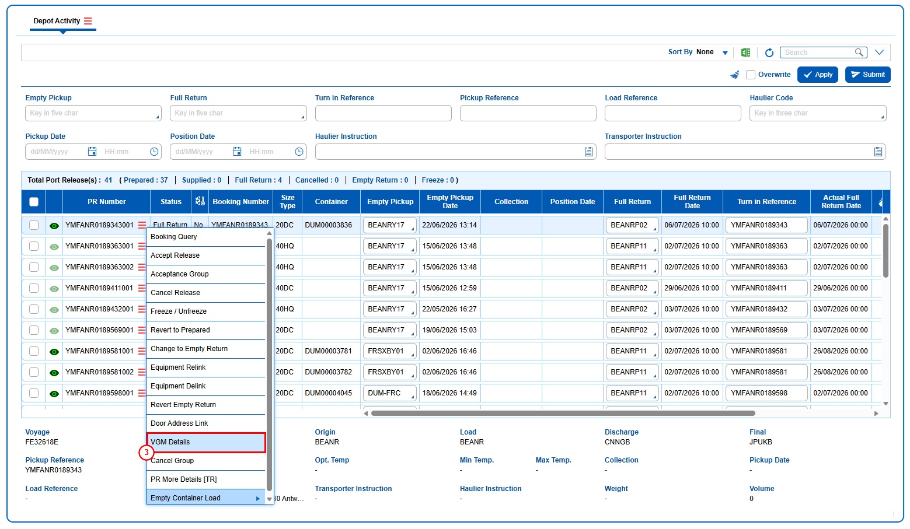
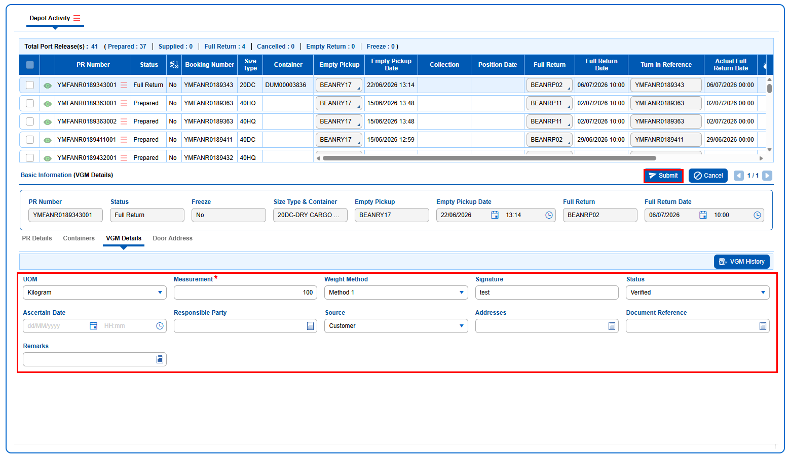
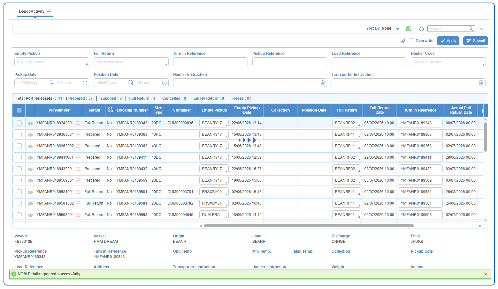

## Pre defined conditions

PR Status must be in "**Prepared**" status.

## Steps

1. **Step 1** : The user should query data using the query fields.
**Step 2** : The user should the click on the Menu icon near the desired PR Number and this opens a drop down menu with a list of single functions.
**Step 3** : The user should then click on "**VGM Details**".

**Step 4** : On clicking &D**VGM Details&D** from the menu, the user will be taken to VGM Details section will be displayed in the same tab.
**Step 5** : The user can edit details manually.
**Step 6** : Once the user has entered the required details, the user should click on the &D**Submit**&D Button to save container details.

If process is successful, a success message is shown as given below

