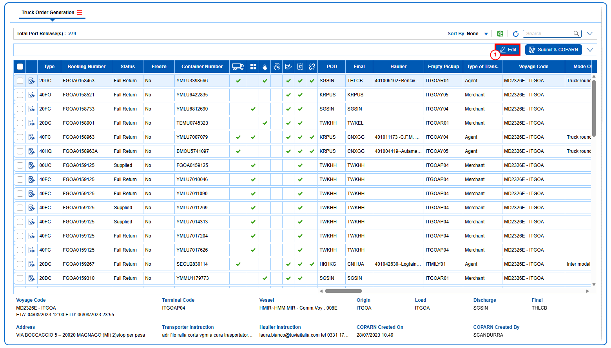
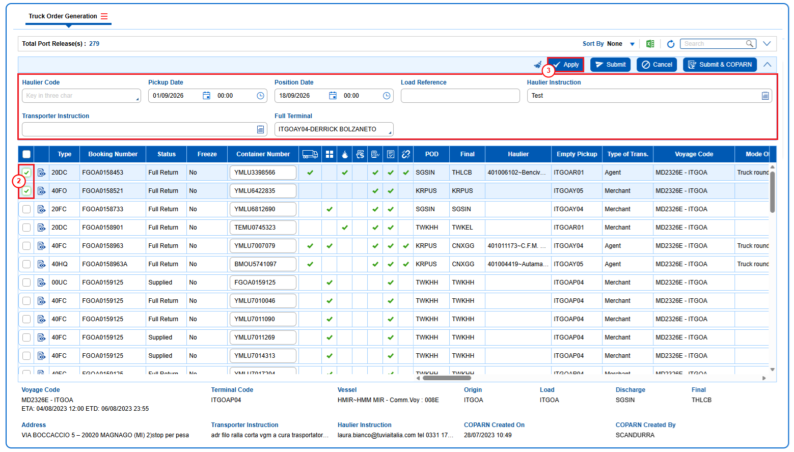
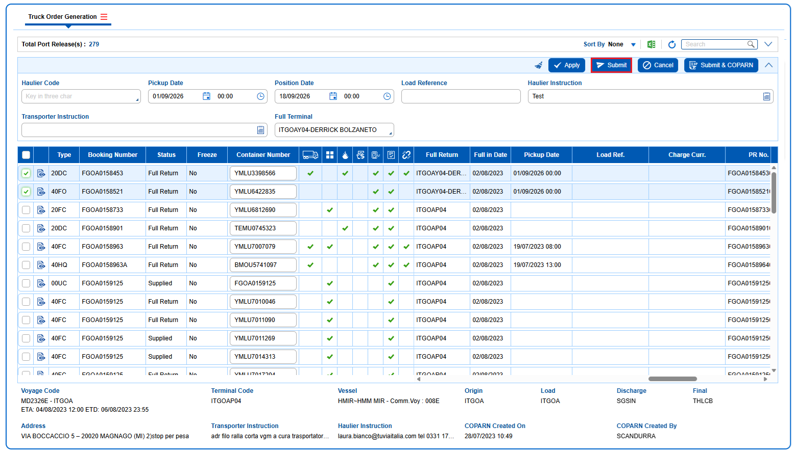
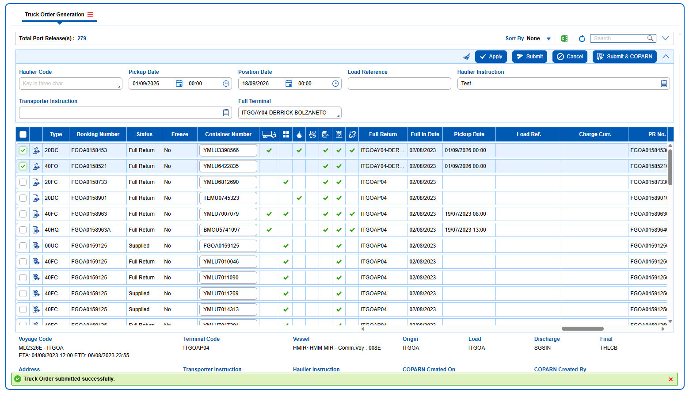

**Step 1** : The user should query depot activity data using depot activity query fields and click on {img:img/How_to_Change_Empty_Return_Full_Return_Edit_Fields_ff7f_01.png}

**Step 2** : The user should then select the records where the user wants to change data.
                1. **Step 3** : After the user selects data the user should enter desired data in the Edit fields as highlighted below and click on {img:img/How_to_Change_Empty_Return_Full_Return_Edit_Fields_ff7f_03.png}

    1. **Step 4** : If successfully applied, the data will be changed for selected columns.
    1. **Step 5** : Click on {img:img/How_to_Change_Empty_Return_Full_Return_Edit_Fields_ff7f_05.png}.

If the process is successful, a success message as shown below.

    1.
