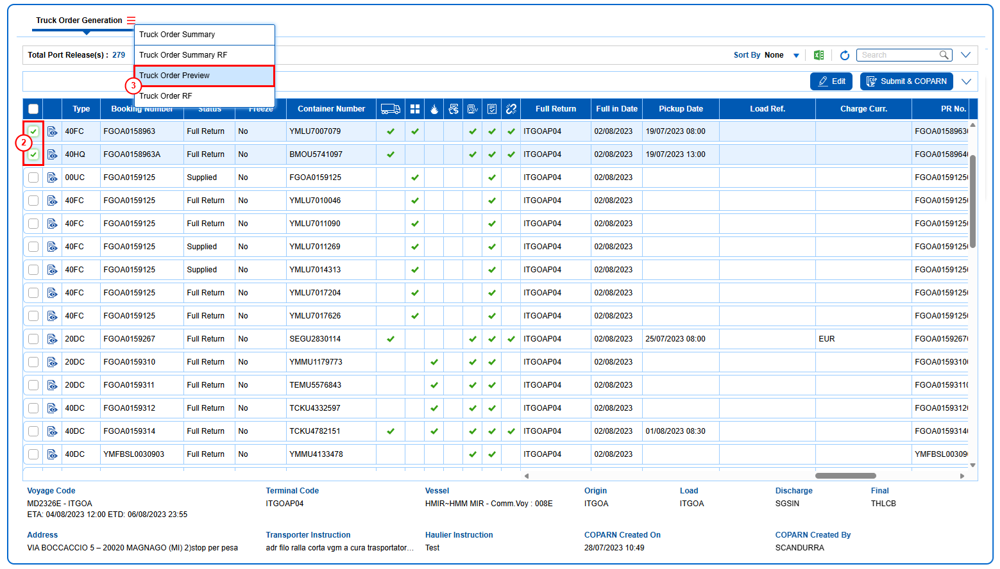

## Pre defined conditions

Truck order must be generated.

## Steps

**Step 1** : Query data using the query fields.
**Step 2** : Click on the checkboxes to select required bookings from queried bookings.
1.   **Note** **:** The user can select one or many bookings at a time to generate Truck Order Summary.
**Step 3** : Click on the Menu icon near depot activity and this opens a drop down menu with a list of Group functions
**Step 4** : Click on "**Truck Order Preview**".

If process is successful, a pdf file is displayed .
>> {img:img/How_to_Generate_Truck_Order_Preview_99d3_02.png}
