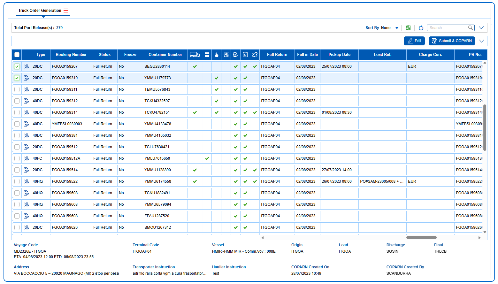
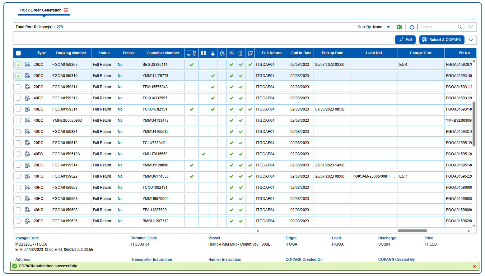

**Step 1** : The user should query depot activity data using depot activity query fields.
**Step 2** : Click on {img:img/How_to_Submit_COPARN_6cdd_01.png}

If the process is successful, a success message as shown below.

    1.
