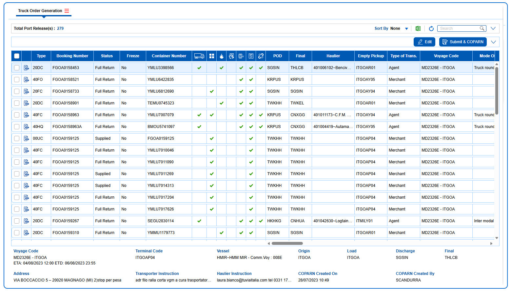

@11 Data Grid Screen allows the user to view data queried using query fields.
@11 This screen allows the user to overwrite existing data like Haulier Code, Pickup Date etc.
@11 This screen allows the user to access Truck order generation group function menu.

