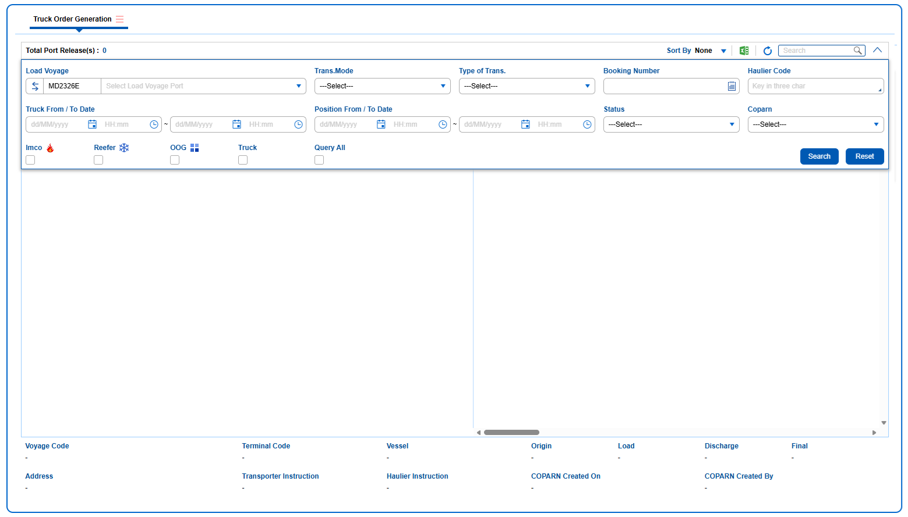

@11 The Query Fields of Truck Order Generation allows the user to query  Truck Order Generation data as per requirement.

@11 {img:img/Truck_Order_Generation_Query_Fields_c9f7_02.png}- This button allows the user to query data by entering data in fields.
@11 {img:img/Truck_Order_Generation_Query_Fields_c9f7_03.png}- This button allows the user to clear multiple fields at once to query with new data, if required.
