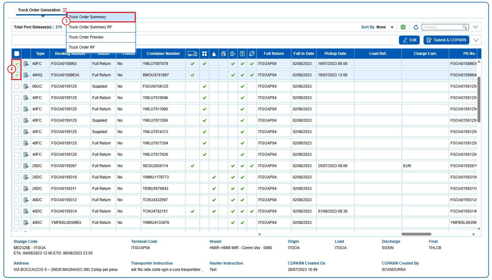

## Pre defined conditions

Truck order must be generated.

## Steps

**Step 1** : Query data using the query fields.
1. **Step 2** : Click on the checkboxes to select required bookings from queried bookings.
**Step 3** : Click on the Menu icon near depot activity. In the menu, Click on "**Truck Order Summary**".

>> 
