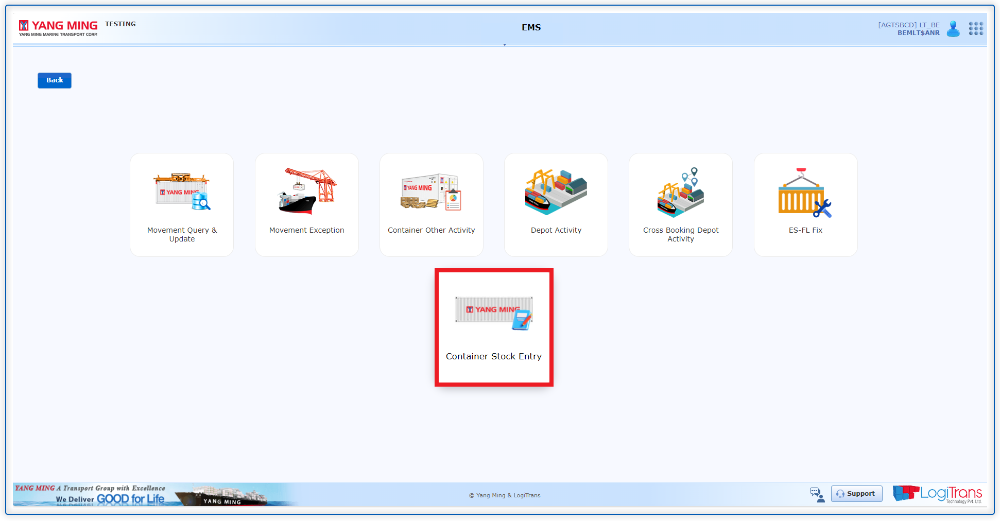

@11 Container Stock Entry allows the user to maintain the container type wise stock entry per depot.
@11 The screen has provision to update the stock as per EDI’s received from depot – Update inventory option.

