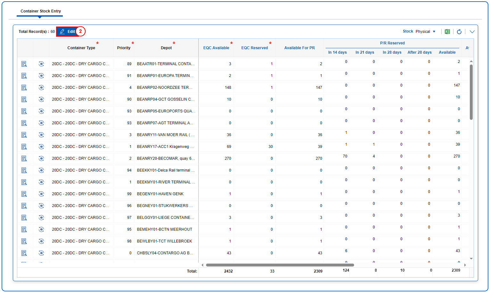
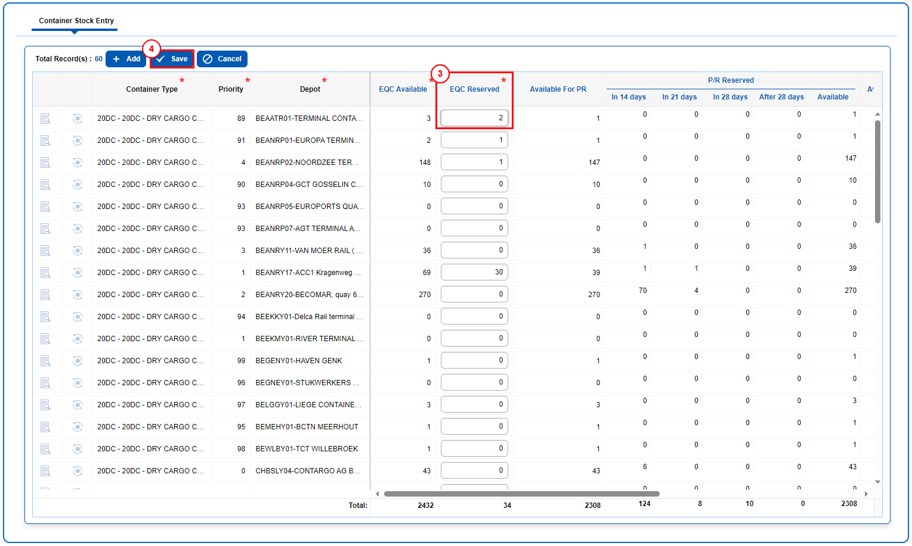
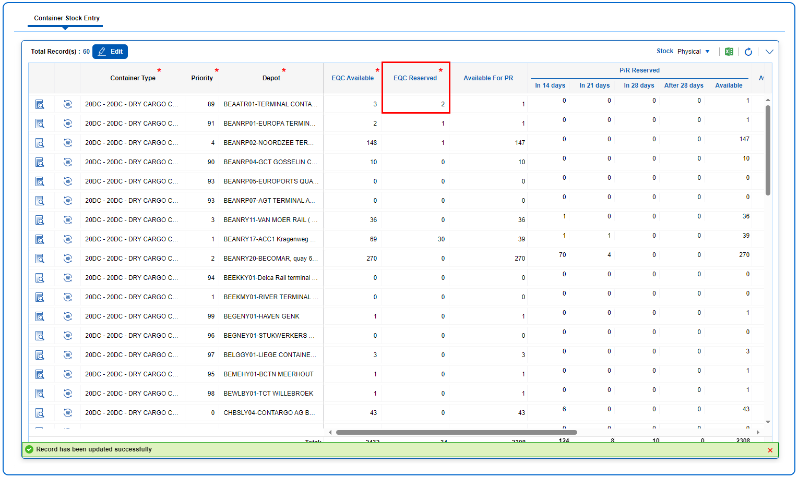

## Pre defined conditions

1) EQC Reserved Cannot be greater than EQC Available

## Steps

**Step 1** : After querying using query fields, data is displayed as per query.
**Step 2** : Click on {img:img/How_to_Edit_EQC_reserved_data_f5f8_01.png} button.

**Step 3** : The EQC Reserved Column is made editable, Enter a desired value.
**Step 4** : Click on {img:img/How_to_Edit_EQC_reserved_data_f5f8_03.png} to save edited data.

If data is successfully edited, then a success message is displayed and the value in EQC Reserved is updated.

