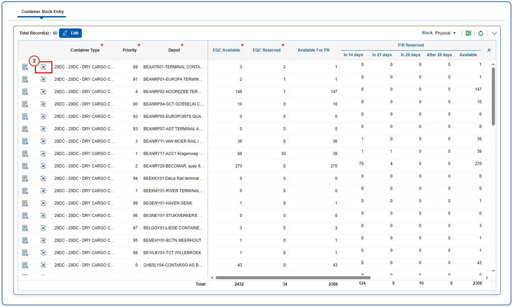
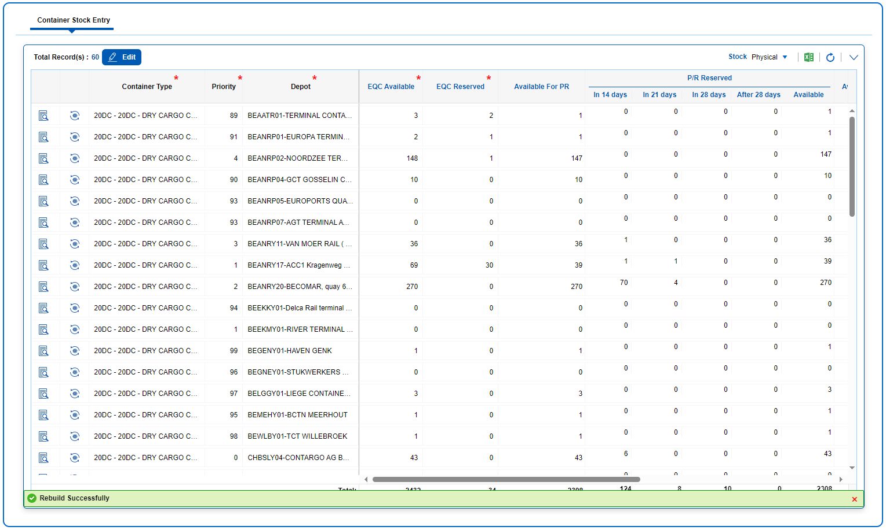

## Steps

**Step 1** : After querying using query fields, data is displayed as per query.
**Step 2** : Click on {img:img/How_to_Process_Re_Build_details_f295_01.png} icon, this process Re-Build Details.

If successfully processed, then a success message is displayed.

