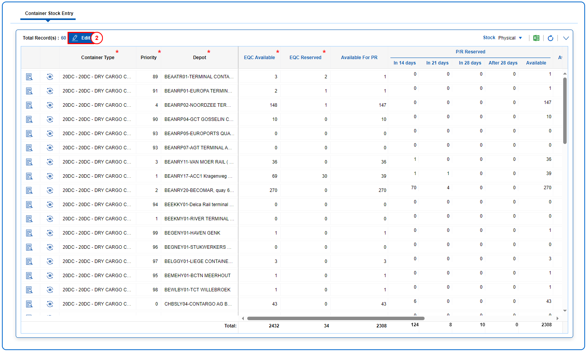
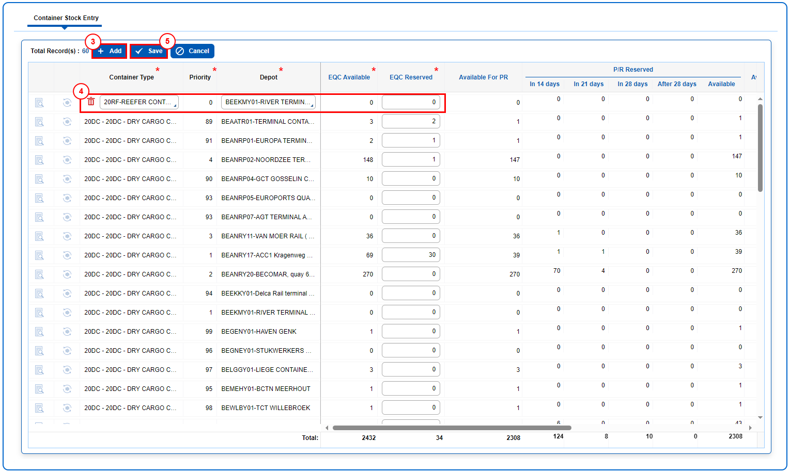
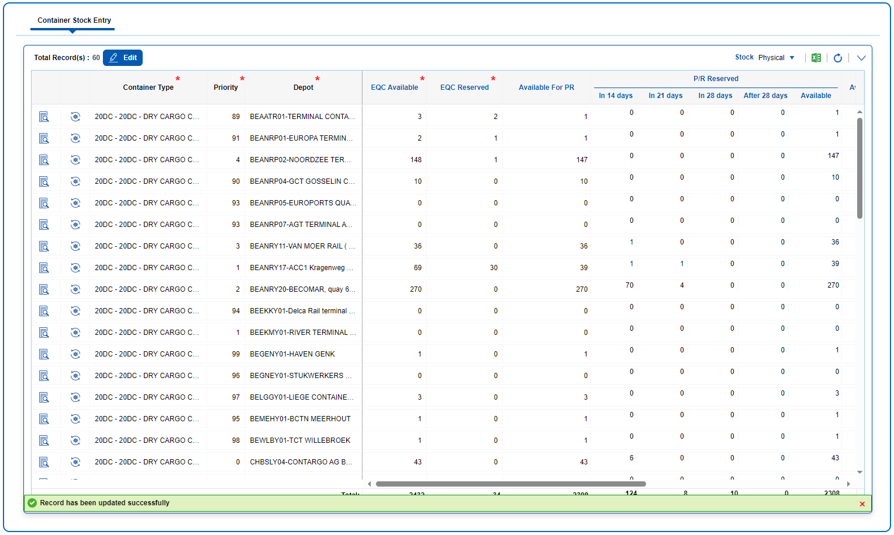
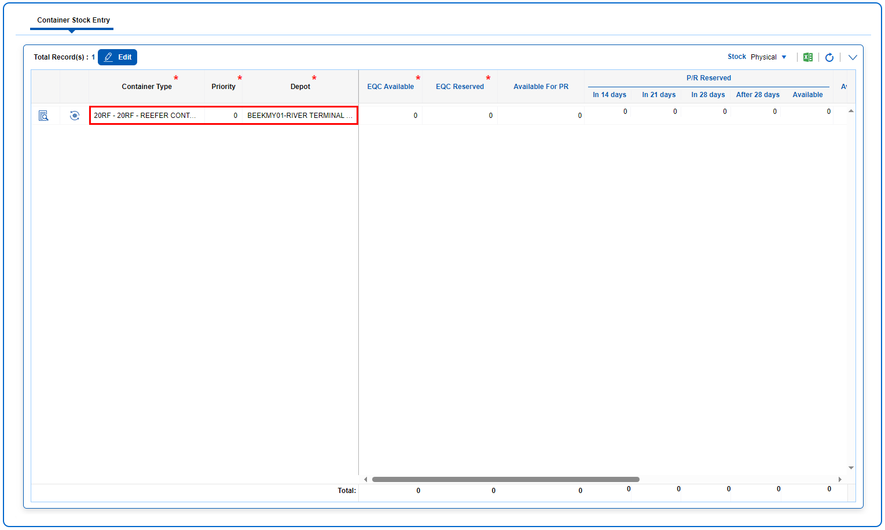

## Pre defined conditions

1) EQC Reserved Cannot be greater than EQC Available

## Steps

**Step 1** : After querying using query fields, data is displayed as per query.
**Step 2** : Click on {img:img/How_to_add_records_in_Container_Stock_Entry_334b_01.png} button.

**Step 3** : Click on {img:img/How_to_add_records_in_Container_Stock_Entry_334b_03.png} to add an additional record.
**Step 4** : Enter **Container Type**, **Depot** and **EQC Reserved** data in respective fields.
**Note :** {img:img/How_to_add_records_in_Container_Stock_Entry_334b_04.png}  This button deletes newly added record
**Step 5** : Click on {img:img/How_to_add_records_in_Container_Stock_Entry_334b_05.png} to save added data.

If data is successfully added, then a success message is displayed and the new data is added .

