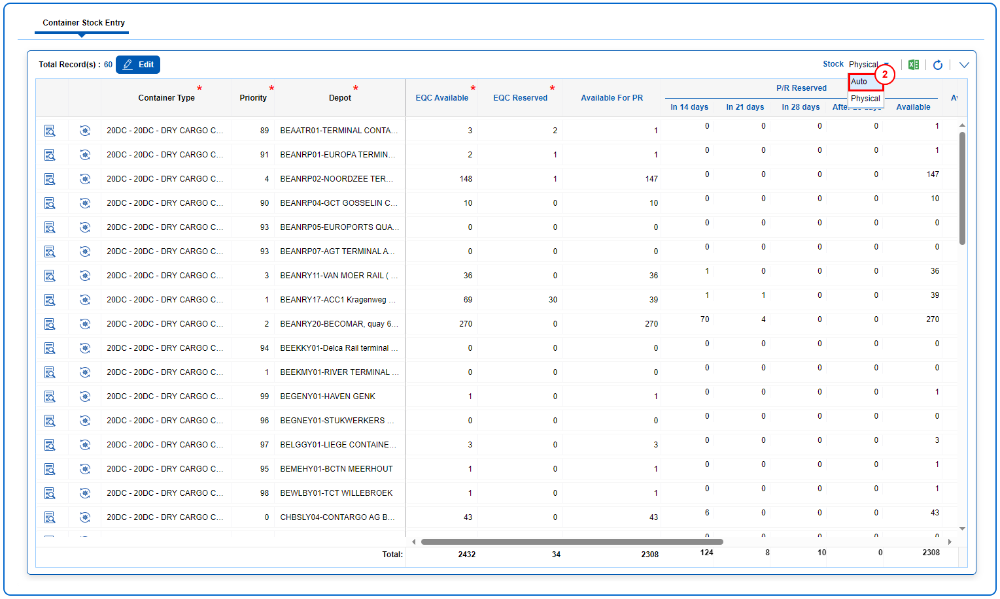
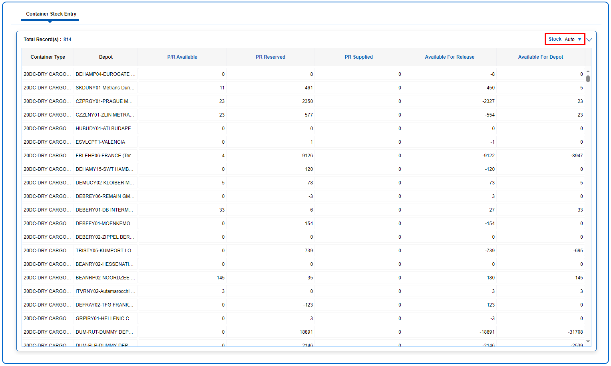

## Steps

**Step 1** : After querying using query fields, data is displayed as per query.
**Step 2** : Click on {img:img/How_to_view_Auto_Stock_Data_c486_01.png} , this displays a menu as shown below, Click on {img:img/How_to_view_Auto_Stock_Data_c486_02.png}.

If Data is available, then it is shown as given below.
**Note**:
The Auto - Stock data is not editable, it is view only.
If user wants to view physical stock data, then click on {img:img/How_to_view_Auto_Stock_Data_c486_04.png} , this displays a menu as shown below, Click on " **Physical**".

