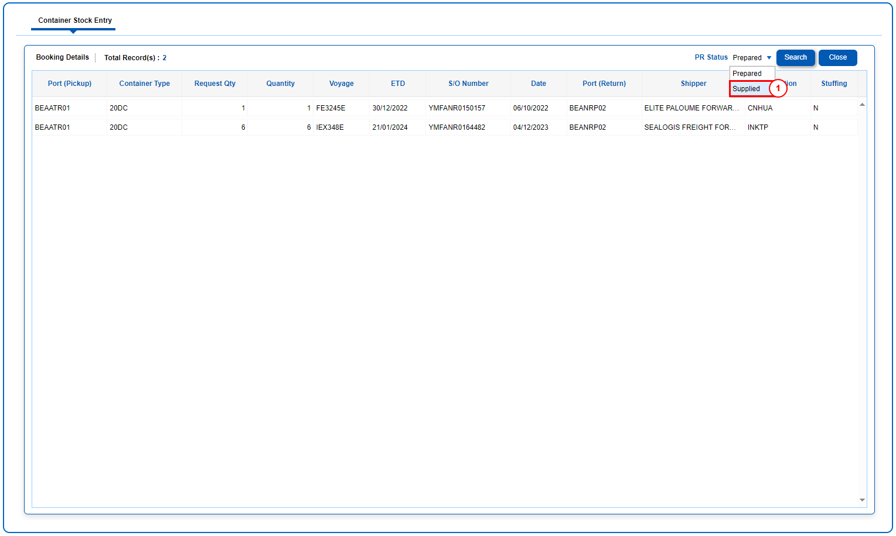
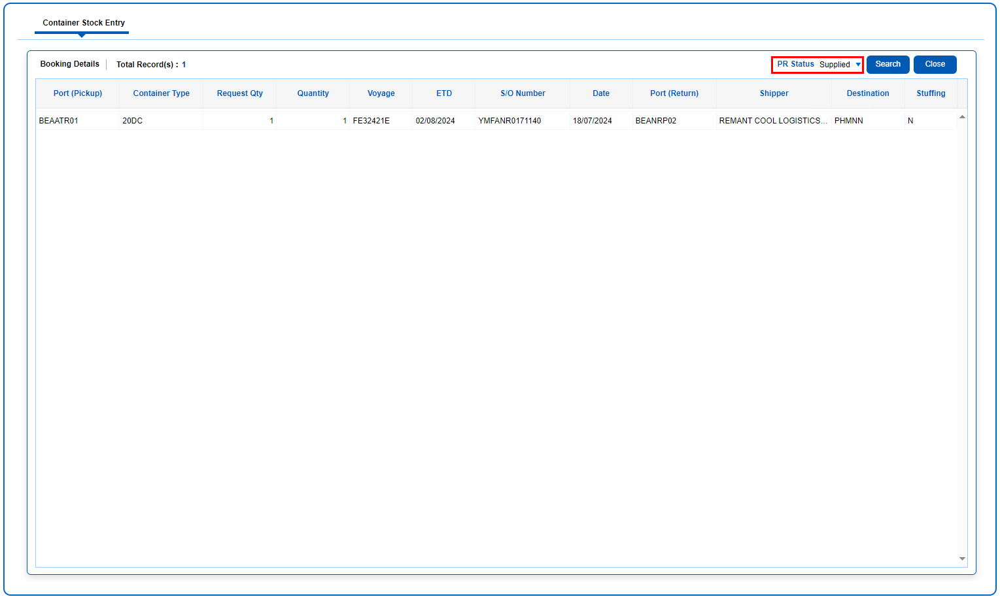

## Steps
**Step 1** : In the Booking Details screen, click on {img:img/How_to_view_Booking_Numbers_with_Supplied_PR_Statu_f8f3_01.png} , this displays a menu as shown below, Click on {img:img/How_to_view_Booking_Numbers_with_Supplied_PR_Statu_f8f3_02.png}.

If Data is available, then it is shown as given below.
**Note**:
The Auto - Stock data is not editable, it is view only.
If user wants to view "**Prepared**" status booking details, then click on {img:img/How_to_view_Booking_Numbers_with_Supplied_PR_Statu_f8f3_04.png} , this displays a menu as shown below, Click on "**Prepared**".

